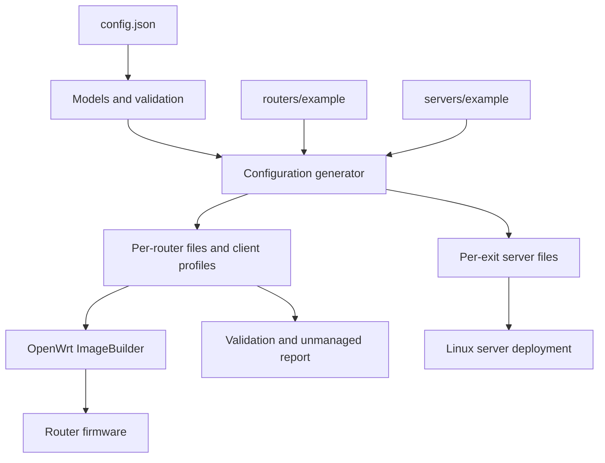
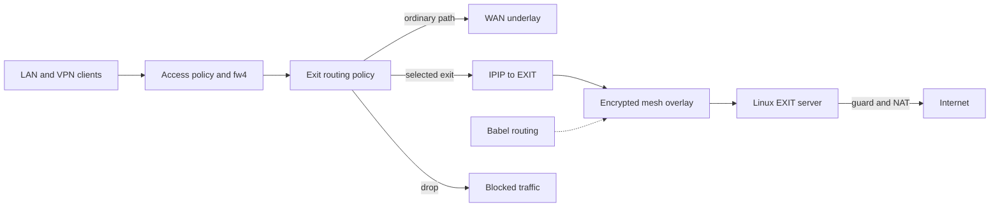

# Архитектура OpenWrt Spine-Leaf Mesh Builder

## Назначение и границы

Проект строит маршрутизируемую L3 mesh-сеть из OpenWrt-роутеров и Linux EXIT-серверов.
Из единой модели он выпускает конфигурации узлов, клиентские профили, серверные файлы
и образы прошивок. Во время работы узлы самостоятельно поддерживают связность,
политики доступа, выбор интернет-выхода и восстановление отдельных служб.

Это карта существующей архитектуры, а не руководство по установке или план развития.
Подробности формата `config.json`, команд и параметров приведены в `README.md`.

Подробные решения по подсистемам:
[TOPOLOGY](docs/architecture/TOPOLOGY.md),
[OVERLAY](docs/architecture/OVERLAY.md),
[ROUTING](docs/architecture/ROUTING.md),
[ACCESS](docs/architecture/ACCESS.md),
[EXIT](docs/architecture/EXIT.md),
[FIREWALL](docs/architecture/FIREWALL.md),
[DNS](docs/architecture/DNS.md),
[PROVISIONING](docs/architecture/PROVISIONING.md),
[RECOVERY](docs/architecture/RECOVERY.md),
[OPERATIONS](docs/architecture/OPERATIONS.md).

## Общая схема

Генерация и работа сети разделены. Python-код выполняется при подготовке артефактов,
а на роутерах действуют OpenWrt, системные сетевые компоненты и shell-службы.
Linux EXIT-серверы имеют собственные службы и отдельную модель firewall.

## Подсистемы и ответственность

| Подсистема | Ответственность | Где искать |
|---|---|---|
| Модель | Узлы, связи и политики | `tools/config_model.py`, `tools/config_builder.py` |
| Генерация | Выпуск артефактов | `generate_configs.py`, `tools/generate.py` |
| Шаблоны и merge | Копирование файлов и сохранение заданных частей | `tools/sync_rules.py` |
| UCI-секции | Разбор UCI и сравнение с ожидаемым результатом | `tools/uci.py`, `tools/managed_blocks.py` |
| Проверки | Валидация модели и результата | `tools/validate*.py` |
| Секреты | Ключи и идентичности | `tools/secrets.py`, `tools/materials.py` |
| Сборка | Образы OpenWrt | `build_router_images.py` |
| Доставка | Deploy и обновления | `deploy_servers.py`, `upgrade_routers.py` |
| Эксплуатация | Команды и состояние узлов | `run_routers.py`, `run_servers.py` |
| Топология | Метрики и визуализация | `collect_link_speeds.py`, `render_topology_*.py` |

`generate_configs.py --clean` удаляет производные деревья для узлов текущей
модели без генерации новых конфигураций. Перед очисткой извлекаются
минимальные ключевые UCI-блоки из `network_part`, секреты из EXIT `.conf`,
Access-CA и клиентские профили и пользовательская часть
`99-firstboot-custom`. Затем каталоги заменяются минимальными деревьями;
шаблоны `example` не трогаются. Ранее сгенерированный `exit_route`
удаляется без сохранения его настроек: они выводятся из `config.json`.
Обычный `generate_configs.py` выполняет такую очистку автоматически перед
пересозданием конфигураций, после проверки модели и загрузки внешних пакетов.
Отдельный `--update-packages` не генерирует конфигурации и не очищает
ключевой материал: удаляет только общий кэш APK и пакеты всех генерируемых
роутеров, скачивает актуальные релизы и копирует их в каталоги роутеров.
При неудаче скачивания старый кэш не восстанавливается.

Это подготовка к следующей генерации,
а не готовый deploy artifact. Старые неописанные в `config.json` каталоги
вызывают ошибку вместо неявного удаления секретов.

`routers/<router>` и `servers/<exit>` - производные каталоги, а не независимые
источники проектирования сети. Генератор выводит индивидуальные параметры из модели,
добавляя общий шаблон. `network_part`, `firewall_part` и `dhcp_part` полностью
генерируются; ручные изменения в них удаляются. Пользовательские UCI-настройки
вносятся через `99-firstboot-custom`, а DHCP-хосты и их опции - через `routers[].dhcp_hosts`
в `config.json`. Ключевой материал имеет отдельный жизненный цикл;
локальные настройки `exit_route` не сохраняются при повторной генерации.

### Навигация по задачам

| Задача | С чего начать |
|---|---|
| Модель и адресация | `tools/config_builder.py`, `tools/generate_mesh.py` |
| Туннели, маршруты, Babel | `tools/generate_network.py`, `tools/generate_exit.py` |
| Доступ и firewall | `tools/generate_access.py`, `tools/generate_firewall.py` |
| Режимы EXIT и списки направлений | `tools/generate_runtime.py`, `routers/example/files/etc/scripts/exit-route.sh` |
| Обновление `main` / `direct` и защита EXIT | `routers/example/files/etc/scripts/update-ipsets.sh`, `servers/example/etc/awg-server.sh` |
| DNS, watchdog и запуск на OpenWrt | `routers/example/files/etc/scripts/`, `routers/example/files/etc/init.d/` |
| Первый запуск и изменения шаблонов | `routers/example/files/etc/uci-defaults/99-firstboot-custom`, `tools/sync_rules.py` |
| Развёртывание и сборка | `build_router_images.py`, `deploy_servers.py`, `upgrade_routers.py` |

Внутренние Python-модули импортируются только через пакет `tools` и
запускаются как `python -m tools.<module>`, если имеют CLI. Общего модуля
переэкспорта `tools/common.py` нет: каждый компонент импортирует зависимости
из модулей-владельцев. Верхнеуровневые entrypoints остаются прежними.

## Сетевая архитектура

**Underlay.** Провайдерские IP-сети, публичные адреса и NAT дают исходную связность.
Публичные spine-узлы принимают соединения; leaf-узлы могут подключаться из-за NAT.
В модели также есть access-only роутеры и публичные либо обратные EXIT-подключения.
Избыточные связи формируются из топологии, но не делают каждый узел обязательным транзитом.

**Overlay.** AmneziaWG/WireGuard создают защищённые межузловые L3-соединения.
Babel распространяет разрешённые маршруты и выбирает путь внутри overlay.
Внутренние адреса и маршруты не зависят от внешней адресации провайдера.
Статические идентификаторы и служебная адресация формируются воспроизводимо.

**Доставка до EXIT.** Выбранный выход отделён от пути к нему: пользовательский
IPv4-трафик переносится до Linux EXIT-сервера через IPIP поверх mesh.
Промежуточные узлы передают пакеты к EXIT, но не становятся точкой выхода.
Изменение пути Babel само по себе не меняет выбранный EXIT.

**Доступ и firewall.** Подключение по VPN не эквивалентно доступу ко всей сети.
`TrustedAccess` разрешает доступ к принимающему роутеру, `TransitAccess` ограничивает
его, оставляя предусмотренный транзит и служебные исключения. Доступ к другим
роутерам и LAN задаётся отдельно. Firewall-зоны создаются только при наличии
соответствующих интерфейсов (`tools/generate_firewall.py`).

## Управление интернет-выходом

На роутере генератор создаёт постоянную сетевую инфраструктуру и глобальные
firewall-правила. `routers/example/files/etc/scripts/exit-route.sh` периодически
проверяет достижимость EXIT по Babel, выбирает активный выход и через UCI
согласует `network` и `firewall`. Служба изменяет заранее созданный глобальный
маршрут, а правила для индивидуальных устройств может создавать и удалять.
Её желаемые настройки хранятся в `/etc/config/exit_route`.
LuCI редактирует этот файл только через штатный UCI Save & Apply;
`procd` передаёт изменение службе. `run` и `once` выполняют одно
согласование под блокировкой, а `status` лишь сообщает состояние.
Секции устройств задают IPv4 в поле `ip`, а не в имени UCI-секции.
Индивидуальный порядок AUTO (`device.auto_exit`) не меняет общий порядок;
`device.disabled=1` временно отключает переопределение маршрутизации.

Для пользовательского IPv4-трафика код реализует следующую политику.
`main` - более приоритетное исключение, чем `direct`:

| Режим | `main.txt` | `direct.txt` | Остальные назначения | Недоступный EXIT |
|---|---|---|---|---|
| `DIRECT` | main | WAN | WAN | WAN |
| `AUTO` | main | WAN | Первый доступный EXIT | Следующий EXIT, затем WAN |
| `SPLIT_FAIL_OPEN` | main | WAN | Заданный EXIT | WAN |
| `SPLIT_FAIL_CLOSED` | main | WAN | Заданный EXIT | DROP для остального |
| `EXIT_FAIL_OPEN` | main | DROP | Заданный EXIT | WAN для остального |
| `EXIT_FAIL_CLOSED` | main | DROP | Заданный EXIT | DROP для остального |

`main.txt` содержит постоянные исключения, `direct.txt` - обновляемые
списки прямых направлений. Для устройств из LAN также есть `DEFAULT`
(наследование глобальной политики). Доступность EXIT определяется наличием
Babel marker route, а не независимой интернет-проверкой. При отказе
фиксированного выхода только `AUTO` переключается на следующий EXIT.
`SPLIT_FAIL_CLOSED` и `EXIT_FAIL_CLOSED` блокируют fallback на WAN; отдельные
WAN-guard правила защищают также от потери IPIP-маршрута. Исключения `main`
остаются на обычной таблице маршрутизации.

Генератор, runtime-служба и LuCI принимают только актуальные режимы
и опции. Неизвестные или устаревшие параметры отклоняются как ошибки;
версии схемы и автоматические миграции не используются.

Процесс службы восстанавливает procd; сериализация применения использует
`flock`. Изменения UCI и fw4 не атомарны, гарантии отсутствия
кратковременных утечек при reload требуют испытаний на OpenWrt.

Остальной локальный трафик самого роутера обычно использует WAN; для процесса
DoH предусмотрена отдельная привязка к глобальному выбору EXIT.
Инфраструктурная связность mesh отделена от пользовательской политики.

## EXIT-сервер и защита

`servers/example/etc/awg-server.sh` управляет серверными AWG-соединениями,
приёмным IPIP, Babel, пересылкой и NAT. На Linux применяются systemd,
`iptables` и `ipset`, а не роутерный UCI. EXIT-сервер независимо от режима
исходного роутера блокирует назначения из **обоих** списков `main` и `direct`
перед выпуском в интернет. Отдельно действует nDPI-фильтрация BitTorrent.

`update-ipsets.sh` формирует динамический `direct.txt` из выбранных стран и ASN
и оптимизирует CIDR; постоянный `main.txt` ведётся отдельно. Тот же скрипт
используется на OpenWrt и Linux, но получает настройки из разных источников.
На сервере `exit-direct-guard.service` и таймер обновляют списки и защиту.
Обновление ipset не перестраивает действующую цепочку FORWARD.
Одна защитная цепочка устанавливается при `network-up`; при изменении
параметров фильтра требуется повторный `network-up`.

## DNS, восстановление и наблюдаемость

На OpenWrt `dns-failover.sh` выбирает доступный DNS из локальных DoH endpoints
и полученных от провайдера серверов, согласуя настройки dnsmasq через UCI.
`ping-reboot.sh` отдельно контролирует указанные узлы и может перезагрузить
роутер при длительной потере связности. Эти механизмы не заменяют Babel
и не определяют доступность EXIT.

Службы OpenWrt запускаются через procd, серверные - через systemd.
Состояние сети диагностируется через маршруты, статусы служб, логи и
инструменты `run_routers.py`, `run_servers.py` и визуализаторы топологии.

## Основные потоки управления

1. **Изменение топологии:** `config.json` -> загрузка и валидация модели ->
   загрузка пакетов -> очистка производных деревьев -> синхронизация шаблонов ->
   генерация конфигураций -> проверки артефактов.
1. **Развёртывание:** каталоги роутеров -> ImageBuilder -> прошивки ->
   применение UCI-фрагментов на firstboot; каталоги EXIT -> серверный deploy.
1. **Сетевой пакет:** клиент -> политика доступа -> классификация `main/direct`
   и выбор выхода -> обычный маршрут либо IPIP поверх маршрута Babel -> EXIT.
1. **Отказ EXIT:** Babel удаляет marker-маршрут -> следующий опрос службы ->
   пересогласование UCI. Для `AUTO` ищется резерв, для `EXIT_FAIL_CLOSED` путь блокируется.
1. **Обновление списков:** внешние источники -> `direct.txt` -> обновление
   правил роутера и серверного защитного фильтра.

## Архитектурные решения и инварианты

- **Единая модель вместо ручной настройки узлов.** Это облегчает повторную
  генерацию, но требует строгой валидации и явных границ пользовательских правок.
- **Два уровня инкапсуляции.** Защищённый overlay и отдельный IPIP до EXIT
  позволяют независимо выбирать внутренний путь и точку выхода ценой MTU-overhead.
- **Маршрутизация не равна разрешению доступа.** Babel может знать путь, но
  firewall решает, допустимо ли передать пакет.
- **Статика и runtime разделены.** Генератор владеет постоянной инфраструктурой;
  службы согласуют изменяемое состояние без ручной пересборки топологии.
- **Независимость индивидуальных политик.** Правило устройства переопределяет
  глобальный режим; отсутствие правила эквивалентно `DEFAULT`.
- **Защита EXIT многослойная.** Роутер блокирует `direct` в `EXIT_FAIL_OPEN`
  и `EXIT_FAIL_CLOSED`, а в строгих режимах защищает от обхода через WAN.
  При недоступном фиксированном EXIT индивидуальная политика блокирует
  остальные назначения только в `SPLIT_FAIL_CLOSED` и `EXIT_FAIL_CLOSED`; при этом
  `main` остаётся исключением, а `direct` разрешён в `SPLIT_FAIL_CLOSED`.
  Сервер отдельно отбрасывает `main` и `direct`.
  Это описание механизмов, а не подтверждение отсутствия утечек на всех путях.
- **Повторная генерация не должна случайно заменять секреты.** Управляемые
  ключи и пользовательские секции обрабатываются по собственным правилам.

## Ограничения и границы проверенного поведения

- EXIT-политика и индивидуальные правила рассчитаны на IPv4. Политика IPv6
  сознательно пока не включена в возможности EXIT.
- Наличие Babel-маршрута означает сетевую достижимость EXIT, но не исправность
  его внешнего подключения. Смена EXIT может разорвать существующие соединения.
- `network` и `firewall` применяются раздельно: OpenWrt не предоставляет
  единую транзакцию для netifd и fw4. Переходные состояния требуют проверки
  на целевом OpenWrt; отсутствие атомарности само по себе не дефект.
- Индивидуальная политика идентифицирует устройство по IPv4-адресу LAN, а
  не по MAC/DHCP-идентичности. Изменение адреса требует согласования правил.
- Развёртывание образа через `sysupgrade -n` намеренно начинает с чистой
  конфигурации. Runtime-изменения, не перенесённые в исходную модель,
  не обязаны сохраняться при обновлении.
- Генератор и служба разделяют имена управляемых правил. Это внутренний
  контракт поставляемого комплекта, а не независимо версионируемый API.
