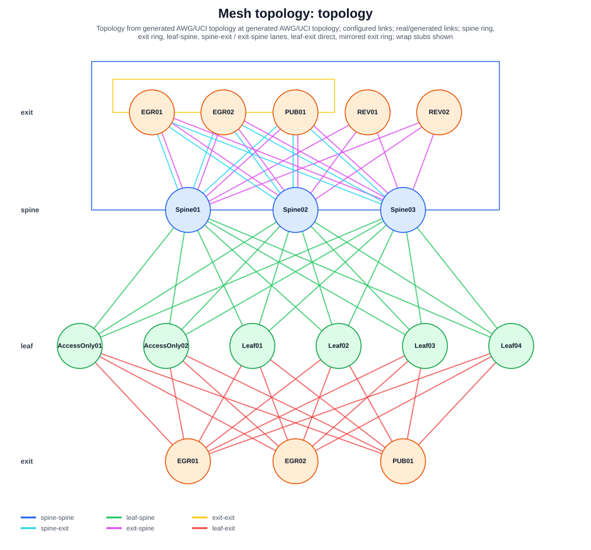
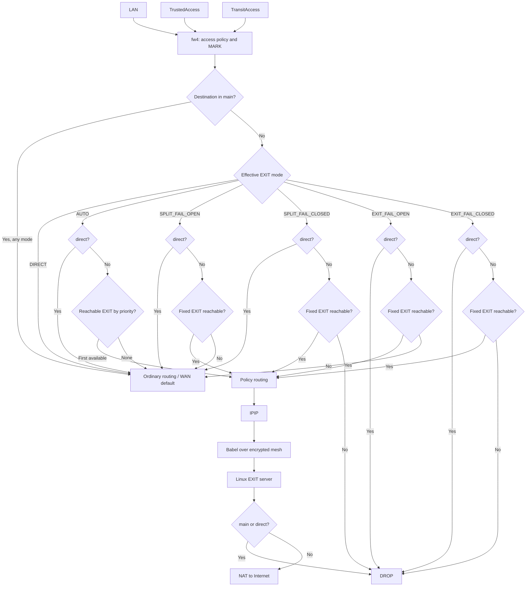

# OpenWrt Spine-Leaf Mesh Builder



OpenWrt Spine-Leaf Mesh Builder generates configurations, firmware images, and deployment
files for routed OpenWrt/Linux mesh networks. It combines overlay links, Babel routing,
managed exit paths, and firewall policy from a single `config.json`.

OpenWrt Spine-Leaf Mesh Builder создаёт конфигурации, образы прошивок и файлы развёртывания
маршрутизируемой mesh-сети из OpenWrt-роутеров и Linux-узлов. Из одного `config.json` он
настраивает оверлейные соединения, Babel, управляемые выходы в Интернет и правила
межсетевого экрана.

## Описание

Топология различает spine-узлы с публичными IP, leaf-узлы за NAT или с приватными адресами и
управляемые exit-узлы. Помимо сетевой конфигурации, генератор создаёт серверные файлы,
конфигурации клиентов доступа, псевдонимы SSH и настройки IPIP для выходных узлов.

Результат - не один VPN туннель до одного шлюза, а маршрутизируемый оверлей, в котором роутеры доступны друг другу, приватные leaf сети остаются адресуемыми через общую сеть, а пользовательский трафик может переключаться между несколькими управляемыми путями выхода в Интернет. Из той же конфигурации можно собирать образы прошивки через `build_router_images.py`.

Текущая реализация рассчитана на OpenWrt 25.12+ с ImageBuilder на основе apk и пакетами AmneziaWG 3.1. Проект намеренно задаёт строгие правила адресации, генерации конфигурации и порядка развертывания, чтобы сеть из нескольких роутеров можно было воспроизводить, а не собирать вручную по одному узлу.

## Содержание

- [Навигация](#%D0%BD%D0%B0%D0%B2%D0%B8%D0%B3%D0%B0%D1%86%D0%B8%D1%8F)
- [Разработка и проверка изменений](#%D1%80%D0%B0%D0%B7%D1%80%D0%B0%D0%B1%D0%BE%D1%82%D0%BA%D0%B0-%D0%B8-%D0%BF%D1%80%D0%BE%D0%B2%D0%B5%D1%80%D0%BA%D0%B0-%D0%B8%D0%B7%D0%BC%D0%B5%D0%BD%D0%B5%D0%BD%D0%B8%D0%B9)
  - [Поток генерации и точки изменения](#%D0%BF%D0%BE%D1%82%D0%BE%D0%BA-%D0%B3%D0%B5%D0%BD%D0%B5%D1%80%D0%B0%D1%86%D0%B8%D0%B8-%D0%B8-%D1%82%D0%BE%D1%87%D0%BA%D0%B8-%D0%B8%D0%B7%D0%BC%D0%B5%D0%BD%D0%B5%D0%BD%D0%B8%D1%8F)
  - [Типовые изменения](#%D1%82%D0%B8%D0%BF%D0%BE%D0%B2%D1%8B%D0%B5-%D0%B8%D0%B7%D0%BC%D0%B5%D0%BD%D0%B5%D0%BD%D0%B8%D1%8F)
  - [Инварианты для правок](#%D0%B8%D0%BD%D0%B2%D0%B0%D1%80%D0%B8%D0%B0%D0%BD%D1%82%D1%8B-%D0%B4%D0%BB%D1%8F-%D0%BF%D1%80%D0%B0%D0%B2%D0%BE%D0%BA)
- [Требования](#%D1%82%D1%80%D0%B5%D0%B1%D0%BE%D0%B2%D0%B0%D0%BD%D0%B8%D1%8F)
- [Быстрый старт](#%D0%B1%D1%8B%D1%81%D1%82%D1%80%D1%8B%D0%B9-%D1%81%D1%82%D0%B0%D1%80%D1%82)
- [Что это даёт](#%D1%87%D1%82%D0%BE-%D1%8D%D1%82%D0%BE-%D0%B4%D0%B0%D1%91%D1%82)
- [Идея сети](#%D0%B8%D0%B4%D0%B5%D1%8F-%D1%81%D0%B5%D1%82%D0%B8)
- [Отказоустойчивость](#%D0%BE%D1%82%D0%BA%D0%B0%D0%B7%D0%BE%D1%83%D1%81%D1%82%D0%BE%D0%B9%D1%87%D0%B8%D0%B2%D0%BE%D1%81%D1%82%D1%8C)
- [Spine-leaf на домашних и пограничных роутерах](#spine-leaf-%D0%BD%D0%B0-%D0%B4%D0%BE%D0%BC%D0%B0%D1%88%D0%BD%D0%B8%D1%85-%D0%B8-%D0%BF%D0%BE%D0%B3%D1%80%D0%B0%D0%BD%D0%B8%D1%87%D0%BD%D1%8B%D1%85-%D1%80%D0%BE%D1%83%D1%82%D0%B5%D1%80%D0%B0%D1%85)
- [Сетевые слои](#%D1%81%D0%B5%D1%82%D0%B5%D0%B2%D1%8B%D0%B5-%D1%81%D0%BB%D0%BE%D0%B8)
- [Адресация без ручного IPAM](#%D0%B0%D0%B4%D1%80%D0%B5%D1%81%D0%B0%D1%86%D0%B8%D1%8F-%D0%B1%D0%B5%D0%B7-%D1%80%D1%83%D1%87%D0%BD%D0%BE%D0%B3%D0%BE-ipam)
- [Что проект делает](#%D1%87%D1%82%D0%BE-%D0%BF%D1%80%D0%BE%D0%B5%D0%BA%D1%82-%D0%B4%D0%B5%D0%BB%D0%B0%D0%B5%D1%82)
- [Модель сети](#%D0%BC%D0%BE%D0%B4%D0%B5%D0%BB%D1%8C-%D1%81%D0%B5%D1%82%D0%B8)
  - [Роутеры](#%D1%80%D0%BE%D1%83%D1%82%D0%B5%D1%80%D1%8B)
  - [Узлы spine (mesh hub)](#%D1%83%D0%B7%D0%BB%D1%8B-spine-mesh-hub)
  - [Выходные узлы (exit hub)](#%D0%B2%D1%8B%D1%85%D0%BE%D0%B4%D0%BD%D1%8B%D0%B5-%D1%83%D0%B7%D0%BB%D1%8B-exit-hub)
  - [Узлы доступа](#%D1%83%D0%B7%D0%BB%D1%8B-%D0%B4%D0%BE%D1%81%D1%82%D1%83%D0%BF%D0%B0)
- [Как строятся линки](#%D0%BA%D0%B0%D0%BA-%D1%81%D1%82%D1%80%D0%BE%D1%8F%D1%82%D1%81%D1%8F-%D0%BB%D0%B8%D0%BD%D0%BA%D0%B8)
  - [Диверсификация AWG 3.1](#%D0%B4%D0%B8%D0%B2%D0%B5%D1%80%D1%81%D0%B8%D1%84%D0%B8%D0%BA%D0%B0%D1%86%D0%B8%D1%8F-awg-31)
- [Служебная адресация](#%D1%81%D0%BB%D1%83%D0%B6%D0%B5%D0%B1%D0%BD%D0%B0%D1%8F-%D0%B0%D0%B4%D1%80%D0%B5%D1%81%D0%B0%D1%86%D0%B8%D1%8F)
  - [Инфраструктурные P2P-соединения](#%D0%B8%D0%BD%D1%84%D1%80%D0%B0%D1%81%D1%82%D1%80%D1%83%D0%BA%D1%82%D1%83%D1%80%D0%BD%D1%8B%D0%B5-p2p-%D1%81%D0%BE%D0%B5%D0%B4%D0%B8%D0%BD%D0%B5%D0%BD%D0%B8%D1%8F)
  - [Префикс объявления выхода](#%D0%BF%D1%80%D0%B5%D1%84%D0%B8%D0%BA%D1%81-%D0%BE%D0%B1%D1%8A%D1%8F%D0%B2%D0%BB%D0%B5%D0%BD%D0%B8%D1%8F-%D0%B2%D1%8B%D1%85%D0%BE%D0%B4%D0%B0)
  - [Префикс выходного узла](#%D0%BF%D1%80%D0%B5%D1%84%D0%B8%D0%BA%D1%81-%D0%B2%D1%8B%D1%85%D0%BE%D0%B4%D0%BD%D0%BE%D0%B3%D0%BE-%D1%83%D0%B7%D0%BB%D0%B0)
- [Выбор выхода и плоскость данных IPIP](#%D0%B2%D1%8B%D0%B1%D0%BE%D1%80-%D0%B2%D1%8B%D1%85%D0%BE%D0%B4%D0%B0-%D0%B8-%D0%BF%D0%BB%D0%BE%D1%81%D0%BA%D0%BE%D1%81%D1%82%D1%8C-%D0%B4%D0%B0%D0%BD%D0%BD%D1%8B%D1%85-ipip)
- [Прямые списки (direct lists) и защита сервера](#%D0%BF%D1%80%D1%8F%D0%BC%D1%8B%D0%B5-%D1%81%D0%BF%D0%B8%D1%81%D0%BA%D0%B8-direct-lists-%D0%B8-%D0%B7%D0%B0%D1%89%D0%B8%D1%82%D0%B0-%D1%81%D0%B5%D1%80%D0%B2%D0%B5%D1%80%D0%B0)
- [Модель межсетевого экрана OpenWrt](#%D0%BC%D0%BE%D0%B4%D0%B5%D0%BB%D1%8C-%D0%BC%D0%B5%D0%B6%D1%81%D0%B5%D1%82%D0%B5%D0%B2%D0%BE%D0%B3%D0%BE-%D1%8D%D0%BA%D1%80%D0%B0%D0%BD%D0%B0-openwrt)
- [Что генерируется](#%D1%87%D1%82%D0%BE-%D0%B3%D0%B5%D0%BD%D0%B5%D1%80%D0%B8%D1%80%D1%83%D0%B5%D1%82%D1%81%D1%8F)
  - [Для роутеров](#%D0%B4%D0%BB%D1%8F-%D1%80%D0%BE%D1%83%D1%82%D0%B5%D1%80%D0%BE%D0%B2)
  - [Для выходных серверов (exit)](#%D0%B4%D0%BB%D1%8F-%D0%B2%D1%8B%D1%85%D0%BE%D0%B4%D0%BD%D1%8B%D1%85-%D1%81%D0%B5%D1%80%D0%B2%D0%B5%D1%80%D0%BE%D0%B2-exit)
- [Шаблоны, секции managed и пользовательские настройки](#%D1%88%D0%B0%D0%B1%D0%BB%D0%BE%D0%BD%D1%8B-%D1%81%D0%B5%D0%BA%D1%86%D0%B8%D0%B8-managed-%D0%B8-%D0%BF%D0%BE%D0%BB%D1%8C%D0%B7%D0%BE%D0%B2%D0%B0%D1%82%D0%B5%D0%BB%D1%8C%D1%81%D0%BA%D0%B8%D0%B5-%D0%BD%D0%B0%D1%81%D1%82%D1%80%D0%BE%D0%B9%D0%BA%D0%B8)
- [Что делает 99-firstboot-custom](#%D1%87%D1%82%D0%BE-%D0%B4%D0%B5%D0%BB%D0%B0%D0%B5%D1%82-99-firstboot-custom)
- [Контроль связности (watchdog)](#%D0%BA%D0%BE%D0%BD%D1%82%D1%80%D0%BE%D0%BB%D1%8C-%D1%81%D0%B2%D1%8F%D0%B7%D0%BD%D0%BE%D1%81%D1%82%D0%B8-watchdog)
- [DoH и резервирование DNS](#doh-%D0%B8-%D1%80%D0%B5%D0%B7%D0%B5%D1%80%D0%B2%D0%B8%D1%80%D0%BE%D0%B2%D0%B0%D0%BD%D0%B8%D0%B5-dns)
- [Секреты и ключевой материал](#%D1%81%D0%B5%D0%BA%D1%80%D0%B5%D1%82%D1%8B-%D0%B8-%D0%BA%D0%BB%D1%8E%D1%87%D0%B5%D0%B2%D0%BE%D0%B9-%D0%BC%D0%B0%D1%82%D0%B5%D1%80%D0%B8%D0%B0%D0%BB)
- [Ключи SSH и псевдонимы](#%D0%BA%D0%BB%D1%8E%D1%87%D0%B8-ssh-%D0%B8-%D0%BF%D1%81%D0%B5%D0%B2%D0%B4%D0%BE%D0%BD%D0%B8%D0%BC%D1%8B)
- [config.json](#configjson)
  - [Ключи верхнего уровня](#%D0%BA%D0%BB%D1%8E%D1%87%D0%B8-%D0%B2%D0%B5%D1%80%D1%85%D0%BD%D0%B5%D0%B3%D0%BE-%D1%83%D1%80%D0%BE%D0%B2%D0%BD%D1%8F)
  - [Профили устройств](#%D0%BF%D1%80%D0%BE%D1%84%D0%B8%D0%BB%D0%B8-%D1%83%D1%81%D1%82%D1%80%D0%BE%D0%B9%D1%81%D1%82%D0%B2)
  - [Правила проверки конфигурации](#%D0%BF%D1%80%D0%B0%D0%B2%D0%B8%D0%BB%D0%B0-%D0%BF%D1%80%D0%BE%D0%B2%D0%B5%D1%80%D0%BA%D0%B8-%D0%BA%D0%BE%D0%BD%D1%84%D0%B8%D0%B3%D1%83%D1%80%D0%B0%D1%86%D0%B8%D0%B8)
  - [Wi-Fi](#wi-fi)
  - [PPPoE](#pppoe)
- [tools/default.py](#toolsdefaultpy)
- [Основные команды](#%D0%BE%D1%81%D0%BD%D0%BE%D0%B2%D0%BD%D1%8B%D0%B5-%D0%BA%D0%BE%D0%BC%D0%B0%D0%BD%D0%B4%D1%8B)
  - [generate_configs.py](#generate_configspy)
  - [deploy_servers.py](#deploy_serverspy)
  - [build_router_images.py](#build_router_imagespy)
  - [upgrade_routers.py](#upgrade_routerspy)
  - [run_routers.py](#run_routerspy)
  - [run_servers.py](#run_serverspy)
- [Проверка скорости линков](#%D0%BF%D1%80%D0%BE%D0%B2%D0%B5%D1%80%D0%BA%D0%B0-%D1%81%D0%BA%D0%BE%D1%80%D0%BE%D1%81%D1%82%D0%B8-%D0%BB%D0%B8%D0%BD%D0%BA%D0%BE%D0%B2)
- [Визуализация топологии](#%D0%B2%D0%B8%D0%B7%D1%83%D0%B0%D0%BB%D0%B8%D0%B7%D0%B0%D1%86%D0%B8%D1%8F-%D1%82%D0%BE%D0%BF%D0%BE%D0%BB%D0%BE%D0%B3%D0%B8%D0%B8)
  - [Двумерная визуализация (HTML и SVG)](#%D0%B4%D0%B2%D1%83%D0%BC%D0%B5%D1%80%D0%BD%D0%B0%D1%8F-%D0%B2%D0%B8%D0%B7%D1%83%D0%B0%D0%BB%D0%B8%D0%B7%D0%B0%D1%86%D0%B8%D1%8F-html-%D0%B8-svg)
  - [Трёхмерная визуализация (HTML)](#%D1%82%D1%80%D1%91%D1%85%D0%BC%D0%B5%D1%80%D0%BD%D0%B0%D1%8F-%D0%B2%D0%B8%D0%B7%D1%83%D0%B0%D0%BB%D0%B8%D0%B7%D0%B0%D1%86%D0%B8%D1%8F-html)
- [Типовой рабочий цикл](#%D1%82%D0%B8%D0%BF%D0%BE%D0%B2%D0%BE%D0%B9-%D1%80%D0%B0%D0%B1%D0%BE%D1%87%D0%B8%D0%B9-%D1%86%D0%B8%D0%BA%D0%BB)
- [Полезные проверки](#%D0%BF%D0%BE%D0%BB%D0%B5%D0%B7%D0%BD%D1%8B%D0%B5-%D0%BF%D1%80%D0%BE%D0%B2%D0%B5%D1%80%D0%BA%D0%B8)
- [Что важно помнить](#%D1%87%D1%82%D0%BE-%D0%B2%D0%B0%D0%B6%D0%BD%D0%BE-%D0%BF%D0%BE%D0%BC%D0%BD%D0%B8%D1%82%D1%8C)
- [Для чего этот проект](#%D0%B4%D0%BB%D1%8F-%D1%87%D0%B5%D0%B3%D0%BE-%D1%8D%D1%82%D0%BE%D1%82-%D0%BF%D1%80%D0%BE%D0%B5%D0%BA%D1%82)
- [Не цели проекта](#%D0%BD%D0%B5-%D1%86%D0%B5%D0%BB%D0%B8-%D0%BF%D1%80%D0%BE%D0%B5%D0%BA%D1%82%D0%B0)
- [Структура проекта](#%D1%81%D1%82%D1%80%D1%83%D0%BA%D1%82%D1%83%D1%80%D0%B0-%D0%BF%D1%80%D0%BE%D0%B5%D0%BA%D1%82%D0%B0)
- [Краткая памятка](#%D0%BA%D1%80%D0%B0%D1%82%D0%BA%D0%B0%D1%8F-%D0%BF%D0%B0%D0%BC%D1%8F%D1%82%D0%BA%D0%B0)
- [Лицензия](#%D0%BB%D0%B8%D1%86%D0%B5%D0%BD%D0%B7%D0%B8%D1%8F)

## Навигация

Если вы впервые разворачиваете сеть, начните с [требований](#%D1%82%D1%80%D0%B5%D0%B1%D0%BE%D0%B2%D0%B0%D0%BD%D0%B8%D1%8F),
затем перейдите к [быстрому старту](#%D0%B1%D1%8B%D1%81%D1%82%D1%80%D1%8B%D0%B9-%D1%81%D1%82%D0%B0%D1%80%D1%82) и
[типовому рабочему циклу](#%D1%82%D0%B8%D0%BF%D0%BE%D0%B2%D0%BE%D0%B9-%D1%80%D0%B0%D0%B1%D0%BE%D1%87%D0%B8%D0%B9-%D1%86%D0%B8%D0%BA%D0%BB).
Для изменения топологии и политик используйте разделы
[Модель сети](#%D0%BC%D0%BE%D0%B4%D0%B5%D0%BB%D1%8C-%D1%81%D0%B5%D1%82%D0%B8) и [`config.json`](#configjson).
После развёртывания пригодятся [полезные проверки](#%D0%BF%D0%BE%D0%BB%D0%B5%D0%B7%D0%BD%D1%8B%D0%B5-%D0%BF%D1%80%D0%BE%D0%B2%D0%B5%D1%80%D0%BA%D0%B8).
Остальная часть README подробно объясняет устройство сети и генератора.

## Разработка и проверка изменений

**Опорные символы для изменения поведения:**

1. `ConfigData` в `tools/config_model.py` - типизированная модель общей конфигурации; новые поля
   требуют согласования с валидаторами и соответствующими генераторами.
1. `generate_configs.py:main` и `tools/generate.py` - оркестрация генерации и подсистемные
   преобразования; изменяйте источник генерации, а не её выходные каталоги.
1. `build_router_images.py:build_router` и `deploy_servers.py:deploy_one` - отдельные точки
   изменений в построении образов и развёртывании серверов; не смешивайте эти операции с
   генерацией конфигураций.

**Основные точки изменения:**

- `config.json` - описание целевой топологии и параметров;
- `generate_configs.py` - основной сценарий построения конфигураций;
- `tools/config_model.py` - модель конфигурации;
- `tools/validate.py` - проверки конфигураций и ограничений;
- `tools/generate_network.py` - генерация сетевой конфигурации;
- `tools/generate_firewall.py` - генерация правил межсетевого экрана;
- `tools/sync_rules.py` - согласование управляемых и пользовательских блоков;
- `build_router_images.py` - сборка образов OpenWrt;
- `deploy_servers.py` - развёртывание Linux-серверов;
- `upgrade_routers.py` - обновление роутеров.

**Импорты и внутренние утилиты.** Модули `tools` используют только пакетные
относительные импорты, без альтернативных путей `ImportError` и `import *`.
Внутренние CLI запускаются из корня проекта через `python -m tools.<module>`
(например, `python -m tools.secrets --help`). Главные команды в корне
проекта (`./generate_configs.py`, `./deploy_servers.py` и другие) не меняются.

**Проверка изменений:** Источник желаемого состояния - `config.json` и код генераторов, а не вручную изменённые сгенерированные файлы в `routers/` и `servers/`. При правке модели меняйте соответствующие валидаторы и генераторы вместе; сначала используйте проверки из "Полезные проверки", затем генерацию и сравнение результата, и только после этого развёртывание. Секретные ключи и материалы не включайте в логи или примеры.

### Поток генерации и точки изменения

- `generate_configs.py` читает `config.json`, строит `ConfigData`, проверяет
  доступность внешних пакетов, затем перед обычной генерацией выполняет
  очистку производных каталогов (как `--clean`). После этого создаёт каталоги
  роутеров из `routers/example`, синхронизирует шаблоны и пакеты, запускает
  генератор, подготовку SSH-ключей, валидатор и отчёт о пользовательских файлах.
  При обычном запуске список `Updating` / `Removing` выводится по итоговому
  сравнению файлов до очистки и после генерации, включая `authorized_keys`.
  Повторная генерация неизменённых конфигов и SSH-ключей не перечисляет их заново.
- `tools/generate.py` собирает состояния mesh/exit/access; изменения модели
  нужно согласовывать с `tools/config_model.py`, `tools/config_schema.py`,
  соответствующими `tools/generate_*.py` и `tools/validate_*.py`.
- `tools/sync_rules.py` задаёт копирование файлов,
  обновление каталогов и слияние по маркеру для bootstrap. У слияния сохраняется часть
  назначения **до маркера**, а содержимое **после маркера** берется из шаблона.

**Карта внутренних подсистем `tools/`:**

- Загрузка и представление параметров: `config_io.py`, `config_model.py`,
  `config_schema.py` и `config_loaders.py`. Новое поле проходит от JSON
  через модель и проверку схемы до генератора, который его использует.
- Сетевые модели: `net_model.py`, `link_model.py`, `tunnel_model.py`,
  `awg_model.py` и `openvpn_model.py`; формирование конфигураций разделено
  между `generate_mesh.py`, `generate_exit.py`, `generate_access.py`
  и `generate_dhcp.py`. Меняя тип линка, сверяйте модель и генерацию.
- Выходные файлы и синхронизация: `generated_files.py`, `layout.py`,
  `file_ops.py`, `managed_blocks.py` и `sync_rules.py`. Не путайте
  генерацию содержимого с копированием в управляемые каталоги.
- Проверки: `validate_network.py`, `validate_firewall.py`,
  `validate_keys.py`, `validate_uci.py` и `validate_runtime_files.py`
  проверяют разные аспекты выходных конфигураций; общего упоминания
  `validate.py` недостаточно при изменении соответствующей подсистемы.
- Развёртывание и сборка: `remote_exec.py` отвечает за SSH/SCP и
  обработку удалённых команд, `remote_hosts.py` - за выбор адресатов,
  `process.py` - за локальные вызовы внешних программ.
- Визуализация: `topology_data.py` формирует данные, `topology_metrics.py`
  обрабатывает показатели линков, `topology_2d_layout.py` и
  `topology_3d_graph.py` готовят представления. Их потребляют
  соответствующие генераторы HTML/SVG.

**Дополнительные модули по границам ответственности:**

- Исходные модели и ограничения: `access_model.py`, `config_exit_model.py`,
  `config_firewall_model.py`, `config_builder.py` и `identifiers.py`
  работают с ролями доступа, выходными интерфейсами, firewall, сборкой
  модели и допустимыми именами. `stable_model.py` обеспечивает
  воспроизводимое формирование значений.
- Параметры запуска и адресаты: `cli_common.py`, `targets.py`,
  `router_order.py` и `git_utils.py` обрабатывают аргументы, выбор
  узлов, порядок роутеров и информацию Git.
- Генерация и формат OpenWrt: `generate_clients.py`,
  `generate_router_misc.py`, `generate_runtime.py`,
  `generate_server_runtime.py`, `network_config.py` и `uci.py`
  формируют разные клиентские, роутерные и серверные файлы;
  `tools/uci.py` разбирает и записывает UCI-блоки.
- Секреты и ключи: `materials.py`, `secrets.py`, `secrets_cli.py`,
  `openvpn_pki.py` и `wg_keys.py` обрабатывают ключевой материал,
  зашифрованную конфигурацию и генерацию ключей.
- Пакеты и псевдонимы: `package_model.py` и `packages.py` отвечают
  за списки пакетов и APK, `link_alias_model.py` - за имена линков,
  `link_speed_model.py` - за модель результатов измерений.
- Представление топологии: `topology_cli.py` и `topology_index.py`
  задают входы/выходы и индекс генерации; `topology_2d_page.py` и
  `topology_3d_page.py` создают HTML. `topology_svg.py`,
  `topology_svg_colors.py`, `topology_svg_geometry.py` и
  `topology_svg_theme.py` относятся к отдельному SVG-представлению.
- Специализированные валидаторы: `validate_access.py`,
  `validate_awg_helpers.py`, `validate_context.py`, `validate_ports.py`,
  `validate_router_files.py`, `validate_secrets.py` и
  `validate_tunnel_files.py`. При изменении генерируемого формата
  выберите соответствующий валидатор, не ограничиваясь `validate.py`.
- `show_unmanaged_collect.py` определяет, какие файлы и блоки остались
  вне управления генератором; сверяйте его при изменении правил
  синхронизации шаблонов.

**Скрипты шаблона роутера:**
`routers/example/files/etc/init.d/iperf3-server` запускает `iperf3 -s`
через procd. `routers/example/files/etc/scripts/firstboot-maximize-wifi.uc`
подбирает параметры радиоинтерфейсов по данным UCI и `/etc/board.json`.
Это часть шаблона прошивки, а не универсальный хук Python-генератора;
при изменении проверяйте совместимость с целевой версией OpenWrt.

### Типовые изменения

- Новое поле `config.json`: согласуйте модель и схему конфигурации,
  генератор соответствующей подсистемы и ее валидатор.
- Маршруты и firewall: сверяйте `tools/generate_network.py`,
  `tools/generate_firewall.py` и соответствующие правила проверки.
- Копирование шаблонов: изучайте `tools/sync_rules.py` до правок в
  `routers/` и `servers/`, особенно правила удаления и managed-секции.

### Инварианты для правок

- Синхронизация каталогов в `copy_dir` удаляет элементы назначения,
  отсутствующие в шаблоне. Не размещайте пользовательские файлы в таких
  управляемых каталогах, не изучив правила синхронизации.
- `merge_after_mark` требует маркер `FIREWALL_MARKER` и в шаблоне, и в уже
  существующем целевом файле. При отсутствии маркера генерация прекращается;
  сохранённые строки **до маркера** остаются пользовательскими, а всё после
  него заменяется строками шаблона. Общая синхронизация роутеров не является
  одной атомарной транзакцией: файлы предыдущих этапов уже могут измениться
  до этой ошибки. Перед повтором исправьте маркер и проверьте `git diff`.
- При обычной генерации все обязательные APK проверяются и синхронизируются.
  Уже скачанные непустые файлы используются повторно; отсутствующие загружаются.
- `--force` передается генератору и меняет ключи mesh/exit; секреты access
  сохраняются. Считайте этот флаг изменением состояния, а не проверкой.
- Валидатор в `tools/validate.py` сопоставляет сгенерированные файлы, ключи,
  адреса, порты, firewall и маршрутизацию. Изменения генератора должны
  сопровождаться изменениями соответствующих валидаторов.
- Обычный `generate_configs.py` использует существующие непустые APK
  из общего каталога `packages/` и загружает отсутствующие. Для полной
  повторной загрузки из Releases используйте `--update-packages`: он
  сначала удаляет общий кэш и все генерируемые `routers/*/packages/`,
  затем скачивает актуальные APK и распределяет их по роутерам.
  Если скачивание не удалось, старые APK не возвращаются автоматически.
- `sync_router_packages` нормализует имена APK и удаляет из целевого
  `routers/<router>/packages/` все элементы, отсутствующие в наборе
  источников, включая пользовательские файлы. Файлы индексов пакетов
  удаляются и в исходном, и в целевом каталоге. Не используйте этот
  каталог для неуправляемых данных. Синхронизация обязательна при генерации.
- Ключи и содержимое секретов не следует включать в вывод отладки,
  демонстрационные конфиги и отчеты.

## Требования

На build/deploy машине обычно нужны:

```text
python3
Python module cryptography
git
ssh
scp
ssh-keygen
curl
wg
openssl
apk-tools 3.x
tar с поддержкой zst
make
cmake
C compiler (gcc или clang)
```

Для `apk-tools 3.x` нужен `apk`. Также используется `apk adbdump` или `apk manifest`.

Python module `cryptography` нужен для OWMB secret/material markers.

На build/deploy машине также должен быть собран и установлен `cidr-squash`, потому что
`generate_configs.py` использует его для локальной оптимизации dynamic direct-list:

```sh
git clone https://github.com/karen07/cidr-squash.git
cd cidr-squash
cmake --preset release
cmake --build --preset release
sudo cmake --install build/release
```

После установки команда `cidr-squash` должна быть доступна через `PATH`.

На exit серверах `root/deploy.sh` также автоматически собирает и устанавливает `cidr-squash`
из `https://github.com/karen07/cidr-squash`, потому что ежедневный server-side
`update-ipsets.sh` использует тот же оптимизатор, что и роутеры.

В Debian/Ubuntu это обычно пакет:

```text
python3-cryptography
```

В Arch Linux:

```text
python-cryptography
```

Для замеров скорости дополнительно нужны:

```text
iperf3
jq
```

На exit серверах предполагается Ubuntu/Debian compatible Linux с systemd, root доступом и `apt-get`.

Шаблонный `servers/example/root/deploy.sh` ставит:

- Babel
- ipset/iptables tooling
- iperf3
- jq
- AmneziaWG из исходников (GitHub release tags + DKMS)

Если используется другой дистрибутив, нужно адаптировать `servers/example/root/deploy.sh` под его package manager и имена сервисов.

## Быстрый старт

```sh
# 1. Описать сеть
vim config.json

# 2. Сгенерировать конфиги, ключи и проверки.
# Clean archive содержит только routers/example и servers/example.
# Целевые routers/* и servers/* создаются из config.json.
# OWMB master key files создаются автоматически по
# secrets_key_path/materials_key_path.
./generate_configs.py

# Если нужно полностью обновить локальные APK из Releases:
# ./generate_configs.py --update-packages

# 3. Задеплоить exit серверы
./deploy_servers.py

# 4. Собрать OpenWrt firmware образы
./build_router_images.py

# 5. Обновить роутеры образами текущего git commit из images/
./upgrade_routers.py
```

Генератор повторно использует уже скачанные непустые APK, а недостающие
загружает из Releases. Для работы без сети все обязательные APK должны быть
заранее доступны в локальном кэше. Отдельного режима пропуска пакетов нет:
неполные пакетные каталоги приводили бы к неполным образам прошивки.

Hooks запускаются при обычной генерации, поэтому `tools/generate.py` может
требовать `wg` и `openssl` для создания недостающих WireGuard/OpenVPN secrets.

Dynamic direct-list sources из `tools/default.py` должны быть доступны, если
они включены. При обычной генерации `tools/generate.py` запускает
`routers/example/files/etc/scripts/update-ipsets.sh` во временном `IPSETS_DIR`.
Для этого на машине генерации должен быть доступен `cidr-squash`.
Независимые `main.txt` и оптимизированный `direct.txt` затем одинаково
записываются во все generated router и server каталоги.

Для локальной проверки без скачивания country/ASN direct-list IP sets можно
использовать `--skip-direct-downloads`:

```sh
./generate_configs.py --skip-direct-downloads
```

В этом режиме generated `direct.txt` будет содержать только static direct entries:

- `LOCAL_DIRECT_IPSETS`
- `EXIT_DIRECT_STATIC_IPSETS`
- listen IP mesh/exit hubs
- exit IP

## Что это даёт

Главная идея - превратить набор роутеров, VPS и домашних сетей в управляемую routed mesh сеть.

Возможности:

- Multi-exit egress: у роутера может быть несколько exit серверов с приоритетом. Активный выход выбирается по Babel достижимости.
- Связность между роутерами: это не только путь до exit, но и путь до LAN другого роутера, даже если тот за NAT.
- Reverse узлы: leaf router или exit без белого IP сам подключается к spine и становится частью overlay после bootstrap.
- Dynamic routing: Babel перестраивает overlay path при падении линка, spine или exit достижимости.
- Детерминированная адресация: p2p `/31`, node IP, announce prefixes и порты генерируются стабильно из имен и link keys.
- Безопасность не превращается в flat network: firewall zones, `allow_to_router`, `allow_to_lan`, access policies, direct lists и server guard ограничивают, кто куда может ходить.

Итоговый пользовательский эффект простой: если один путь сломался, сеть часто может найти другой.

Если перестроился только внутренний путь до того же exit, внешний сайт продолжает видеть тот же egress NAT IP. Поэтому для пользователя это чаще выглядит как короткая потеря пакетов, а не как полная смена сети.

Если меняется сам selected exit и внешний NAT IP, старые TCP сессии могут оборваться, но новые соединения уйдут через доступный выход.

## Идея сети

Это не набор VPN пиров `каждый с каждым`, а routed fabric с разделением control-plane и data-plane.

Внизу находится обычный WAN/Internet underlay:

- провайдерские сети
- публичные IP
- серые IP
- NAT
- VPS
- домашние роутеры

Поверх него строится encrypted infra overlay из p2p AWG/WG линков.

На этих линках работает Babel, поэтому маршруты внутри сети не прописываются руками для каждой пары узлов, а появляются и исчезают динамически.

Поверх этого есть отдельный exit data-plane. Пользовательский трафик, который должен выйти через exit, не просто отправляется в один VPN интерфейс.

Роутер инкапсулирует его в IPIP до active exit, а маршрут до IPIP endpoint выбирается overlay routing.

Поэтому реальный путь пакета может быть достаточно хитрым:

- через spine
- через другой router
- через другой exit как transit overlay hop, если так сошлась маршрутизация

Благодаря этому multi-exit схема удобнее обычного варианта `один роутер -> один VPN сервер`.

Fabric даёт не только egress в интернет, но и связность между площадками:

- можно разрешить LAN одного роутера ходить к LAN другого
- можно подключить access клиента к одному публичному endpoint и все равно попасть в нужный remote segment
- можно держать exit сервер без входящего public endpoint

При этом связность не означает открытый общий broadcast domain. Проект генерирует routed overlay, а не L2 мост.

Firewall model остается явной:

- LAN, Mesh, Exit, ExitIPIP, TrustedAccess и TransitAccess разделены зонами
- доступ к роутерам и LAN задаётся через `allow_to_router` и `allow_to_lan`
- `main` всегда использует обычную таблицу маршрутов; `direct` идёт напрямую
  в `DIRECT`, `AUTO`, `SPLIT_FAIL_OPEN` и `SPLIT_FAIL_CLOSED`, а в `EXIT_FAIL_OPEN` и `EXIT_FAIL_CLOSED`
  блокируется на роутере
- серверная nDPI-фильтрация ограничивает BitTorrent независимо от direct-list

## Отказоустойчивость

За счет Babel сеть получает практическую отказоустойчивость на уровне маршрутизации.

Если leaf роутер теряет один spine, но видит другой, Babel перестраивает маршрут.

Если public exit недоступен напрямую, путь до его overlay endpoint может пройти через другой живой узел.

Если reverse exit не имеет белого IP, он все равно может подключиться наружу к spine и стать доступным внутри overlay после bootstrap.

За выбор активного egress отвечает `exit-route.sh`.

Он раз в 5 секунд проверяет, какой exit marker prefix виден через Babel, выбирает первый reachable exit из `exit_order` и синхронизирует с ним default route в table `10000`.

Если ни один exit не анонсируется через Babel, служба отключает созданную генератором секцию `network.exit10000`:

```text
disabled=1
```

При этом `AUTO`, `SPLIT_FAIL_OPEN` и `EXIT_FAIL_OPEN` допускают резервный WAN (с различными
правилами для `direct`), а `SPLIT_FAIL_CLOSED` и `EXIT_FAIL_CLOSED` блокируют
резервный WAN для трафика, требующего недоступного выхода. `main` остаётся
отдельным постоянным исключением.

Это не заменяет физическую отказоустойчивость провайдера или питания. Если у узла не осталось ни одного живого пути в fabric, маршрутизировать его уже некуда. Но пока есть альтернативный tunnel path, сеть может переживать падение отдельных линков, spine узлов и exit.

## Spine-leaf на домашних и пограничных роутерах

В ЦОДовой spine-leaf схеме leaf подключает клиентов и серверы, а spine даёт связность между leaf узлами.

Здесь та же идея применяется к домашним роутерам, VPS и NAT.

Роутеры с белым IP становятся spine/hub узлами. Они принимают входящие tunnel связи от:

- leaf роутеров
- других spine
- exit серверов

Роутеры с серым IP или за NAT становятся leaf узлами. Им не нужен входящий доступ из интернета: они сами поднимают outbound туннели ко всем публичным spine.

`access_only` узел похож на edge endpoint: он имеет публичный `listen_ip` и принимает пользовательские access группы, но не становится transit spine для infra mesh.

Exit серверы подключаются к fabric и дают управляемый egress в интернет.

Public exit принимает туннели напрямую. Reverse/internal exit сам подключается к spine и работает через overlay.

Так получается почти ЦОДовая модель, но адаптированная под реальность домашних роутеров, VPS и NAT: белые адреса становятся точками агрегации, серые адреса остаются leaf, а маршрутизация между ними остается динамической.

## Сетевые слои

Проект разделяет несколько слоев:

```text
WAN underlay         реальная сеть провайдера, NAT, public IP, VPS
encrypted overlay    p2p AWG/WG линки между router, spine и exit
routing plane        Babel поверх tunnel интерфейсов
exit data-plane      IPIP от роутеров до выбранного exit
policy plane         fwmark, uid rule и routing table 10000
```

AWG/WG линки дают защищенную связность и транспорт для Babel.

Babel отвечает за достижимость overlay узлов и service prefixes.

IPIP используется отдельно как data-plane до exit сервера. Пользовательский трафик, который должен выйти через exit, направляется в table `10000` и уходит через активный IPIP интерфейс.

## Адресация без ручного IPAM

Служебная адресация генерируется детерминированно из имен узлов и link keys.

Не нужно вручную вести таблицу p2p адресов и портов.

Основные идеи:

- infra p2p линки получают `/31` из `INFRA_LINK_POOL`
- exit announce prefixes получают `/31` из `EXIT_ANNOUNCE_SUPERNET4`
- exit node prefixes получают `/31` из `EXIT_NODE_SUPERNET4`
- IPv6 link-local адреса для infra линков строятся из IPv4 адресов
- AWG ports и часть служебных имен также выбираются стабильно
- генератор и validation hook `tools.validate` проверяют пересечения и ошибки

То есть `config.json` описывает намерение:

- какие есть узлы
- кто является spine
- какие есть exit
- какие есть access входы

Низкоуровневые адреса, p2p сети, интерфейсы, firewall zones, Babel config и SSH aliases выводятся из этой модели автоматически.

## Что проект делает

После запуска:

```sh
./generate_configs.py
```

появляются:

- конфиги для OpenWrt роутеров
- конфиги для exit серверов
- AmneziaWG, WireGuard и OpenVPN access группы
- Babel routing поверх tunnel линков
- IPIP data-plane до exit серверов
- firewall zones
- allow rules
- fwmark и policy routing
- direct ipsets для трафика, который не надо отправлять через exit
- server nDPI guard rules для ограничения BitTorrent
- per-router и per-server SSH keys
- SSH config

OpenWrt firmware образы появляются отдельно после:

```sh
./build_router_images.py
```

и складываются в:

```text
images/
```

Сами шаблоны лежат в:

```text
routers/example
servers/example
```

Конкретные узлы создаются рядом с ними после запуска:

```sh
./generate_configs.py
```

## Модель сети

Основные сущности в `config.json`:

```text
openwrt_version    версия OpenWrt по умолчанию, минимум 25.12; поддерживается 25.12-SNAPSHOT
device_profiles    соответствие профиля OpenWrt target/subtarget и apk arch
packages           дополнительные глобальные пакеты для всех роутеров
routers            все OpenWrt роутеры проекта
mesh_hubs          публичные router узлы со spine ролью или access endpoint
exit_hubs          Linux серверы выхода в интернет
exit_order         глобальный приоритет exit серверов
routers[].access   пользовательские WG/AWG/OpenVPN входы на конкретном роутере
```

### Роутеры

`routers` описывает все OpenWrt устройства.

У router задаются:

- `name` - имя узла
- `openwrt_version` - необязательная версия OpenWrt только для этого роутера; перекрывает top-level `openwrt_version`
- `device_profile` - обязательная ссылка на профиль из `device_profiles`
- `subnet` - LAN сеть роутера, обычно canonical `/24`
- `packages` - per-router добавление или удаление дополнительных пакетов
- `wifi_2g`, `wifi_5g`, `wifi_6g` - Wi-Fi параметры
- `pppoe` - необязательные WAN PPPoE credentials и MTU
- `allow_to_router` - к каким target роутерам разрешен INPUT на сам роутер
- `allow_to_lan` - к каким target роутерам разрешен FORWARD в их LAN
- `exit_order` - индивидуальный порядок выбора exit серверов
- `exit_route` - глобальный режим маршрутизации и фиксированный EXIT или порядок AUTO
- `routing_rules` - выбор маршрутизации для отдельного IPv4-устройства
- `access` - пользовательские WG/AWG/OpenVPN входы этого роутера

`allow_to_router` и `allow_to_lan` описывают исходящее разрешение от source сети текущего роутера или access группы к удаленным target роутерам.

Это не входящая ACL на source. Генератор добавляет firewall rules на target роутере. Поскольку Babel может выбрать путь к target как через `Mesh`, так и через `Exit`, разрешение принимается с обоих overlay ingress и не зависит от выбранного Babel next-hop. Явно указывать source router как target запрещено как для router-level, так и для access-group `allow_to_router`/`allow_to_lan`; значение `all` означает все остальные роутеры и также исключает source router. Локальный доступ определяется локальной firewall policy: для access группы - зоной `TrustedAccess`/`TransitAccess`.

Пример:

```json
{
  "name": "Leaf01",
  "openwrt_version": "25.12-SNAPSHOT",
  "device_profile": "asus_rt-ax53u",
  "subnet": "10.101.11.0/24",
  "allow_to_router": ["Spine01"]
}
```

Если `routers[].openwrt_version` не задан, используется top-level
`openwrt_version`. Поэтому в одном deployment можно одновременно держать,
например, большинство роутеров на `25.12.6`, а один роутер на
`25.12-SNAPSHOT`.

В этом фрагменте LAN `Leaf01` может обращаться к самому роутеру `Spine01`.

Пример доступа в LAN других роутеров:

```json
{
  "name": "Leaf04",
  "device_profile": "asus_rt-ax53u",
  "subnet": "10.101.21.0/24",
  "allow_to_lan": ["Spine01", "Leaf01"]
}
```

В этом фрагменте LAN `Leaf04` может форвардиться в LAN `Spine01` и `Leaf01`.

Директория роутера создаётся как lowercase slug:

```text
Spine01 -> routers/spine01/
Leaf03  -> routers/leaf03/
```

### Узлы spine (mesh hub)

`mesh_hubs` добавляет публичную endpoint роль поверх уже описанного router узла.

Пример:

```json
{
  "name": "Spine01",
  "listen_ip": "203.0.113.11"
}
```

Обычный `mesh_hub` становится spine узлом: на нем слушаются infra AmneziaWG линки от leaf роутеров, других spine и exit серверов.

Babel использует эти линки как routed overlay.

Если указать `access_only: true`, узел получает публичный endpoint только для пользовательских access групп, но не становится spine:

```json
{
  "name": "AccessOnly01",
  "listen_ip": "203.0.113.31",
  "access_only": true
}
```

`mesh_hubs[].name` всегда ссылается на существующий router.

`listen_ip` задаётся canonical IPv4 адресом без порта и hostname.

Один и тот же `listen_ip` нельзя использовать в нескольких `mesh_hubs`, включая `access_only` hubs.

### Выходные узлы (exit hub)

`exit_hubs` описывает Linux серверы, через которые пользовательский трафик выходит в интернет.

Пример:

```json
{
  "name": "EGR01",
  "listen_ip": "198.51.100.21",
  "exit_ip": "198.51.100.121"
}
```

Поддерживаются варианты:

| Config | Смысл |
| ---------------------------- | ---------------------------------------------- |
| `name` | Reverse/internal exit без публичного endpoint. |
| `name + listen_ip` | Public exit, принимающий AWG связи. |
| `name + listen_ip + exit_ip` | Public exit с отдельным SNAT адресом. |

`listen_ip` - адрес, куда подключаются tunnel peers.

`exit_ip` - публичный egress адрес для SNAT. Если `exit_ip` не задан, сервер использует MASQUERADE через default interface.

`listen_ip` и `exit_ip` задаются только как canonical usable unicast IPv4 адреса. Hostname и `ip:port` не используются в config модели.

Имя exit сервера ограничено сильнее обычных имен:

```text
A-Z, 0-9, _
первая буква: A-Z
максимум: 8 ASCII bytes
```

Это нужно, чтобы generated Linux IPIP device вида `ipip-ip` помещался в лимит 15 видимых байт.

Директория сервера создаётся как lowercase slug:

```text
EGR01 -> servers/egr01/
REV01 -> servers/rev01/
```

Reverse-only exit без `listen_ip` первично деплоится руками. После bootstrap он получает generated node IP из `EXIT_NODE_SUPERNET4`, и дальнейший SSH/deploy может идти через `server_<name>_node`.

### Узлы доступа

`routers[].access` задаёт пользовательские входы в overlay на конкретном роутере.
Корневой ключ `access` больше не поддерживается.

Поддерживаемые протоколы:

- `wireguard`
- `amneziawg`
- `openvpn`

Пример:

```json
{
  "name": "Spine01",
  "device_profile": "asus_rt-ax59u",
  "subnet": "192.168.8.0/24",
  "access": [
    {
      "name": "AdminWG",
      "protocol": "wireguard",
      "policy": "trusted",
      "port": 45110,
      "subnet": "10.201.1.0/24",
      "allow_to_router": ["all"],
      "allow_to_lan": ["all"],
      "users": ["AdminLaptop", "AdminPhone"]
    }
  ]
}
```

Access группа должна висеть на router узле с публичным endpoint:

- обычном `mesh_hub`
- `access_only` hub

Политики:

| Policy | Firewall zone | Поведение |
| --------- | --------------- | --------------------------------------------------------------------------- |
| `trusted` | `TrustedAccess` | Доступ к самому access роутеру, LAN, Mesh, Exit и WAN. |
| `transit` | `TransitAccess` | Нет доступа к самому роутеру и LAN; разрешен DNS и транзит в Mesh/Exit/WAN. |

`allow_to_router` и `allow_to_lan` у access группы работают так же, как у router.

Source сетью будет subnet access группы, а target роутеры берутся из соответствующего списка.

Access `port` не должен попадать в `INFRA_AWG_PORT_RANGE`, потому что этот диапазон принадлежит generated infra/exit tunnel ports.

Для `protocol: "amneziawg"` параметры AWG можно задать прямо в access группе. AWG 3.0/3.1 поля поддерживают диапазоны, поэтому полный пример выглядит так:

```json
"awg": {
  "jc": 4,
  "jmin": 64,
  "jmax": 205,
  "s1": 56,
  "s2": 48,
  "s3": 32,
  "s4": 16,
  "h1": "1517469637-1517625231",
  "h2": "1615261508-1615356639",
  "h3": "1930310431-1930508571",
  "h4": "2892801623-2893040131",
  "i1": "<r 128>",
  "i2": "",
  "i3": "",
  "i4": "",
  "i5": "",
  "rekey_after_time": "116-142",
  "rekey_timeout": "4-7",
  "reject_after_time": "190-217",
  "keepalive_timeout": "10-15",
  "max_handshake_attempts": "15-21",
  "random_trailers": true,
  "disable_cookies": false,
  "persistent_keepalive": "20-26"
}
```

Этот блок вставляется рядом с `name`, `protocol`, `port`, `subnet` и `users` соответствующей AmneziaWG access группы. Если новые AWG 3.x поля не указаны явно, builder детерминированно выводит их из access group key.

`HeaderProtectionKey` и `ContentPaddingAddition` также поддерживаются как `header_protection_key` и `content_padding_addition`. Если `header_protection_key` не задан явно, builder детерминированно выводит общий 32-byte Base64 key из access/infra link key. При включенном header protection все `S1-S4` должны быть не меньше `12`; generated infra `S1-S4` сразу детерминированно выбираются из диапазонов с нижней границей `12`. `ContentPaddingAddition` оставлен пустым, чтобы transport padding делал `RandomTrailers`.

## Как строятся линки

Infra связи строятся поверх AmneziaWG.

```text
spine-spine ring    между публичными spine
leaf -> spine       каждый leaf подключается ко всем spine
router -> exit      каждый router подключается ко всем public exit
exit -> spine       каждый exit подключается к публичным spine
exit-exit ring      между public exit серверами
```

Reverse exit без `listen_ip` не принимает входящие tunnel связи от роутеров. Он сам поднимает outbound туннели к публичным spine и становится доступен внутри overlay после bootstrap.

На infra линках не включается обычный default route. Они используются как транспорт для Babel и служебной маршрутизации.

### Диверсификация AWG 3.1

Infra AWG профиль генерируется детерминированно, но разделен на shared per-link и local per-direction параметры. Это даёт воспроизводимые конфиги без одинакового fingerprint у всех направлений.

| Параметры | Модель |
| --- | --- |
| `S1-S4`, `H1-H4` | shared per-link: одинаковы на обоих концах одного линка |
| `Jc/Jmin/Jmax` | per-direction: `A -> B` и `B -> A` получают разные значения |
| `I1-I5` | per-direction; генерируется 1-2 signature packets размером 64-256 bytes |
| `RekeyAfterTime`, `RekeyTimeout`, `RejectAfterTime` | per-direction ranges |
| `KeepaliveTimeout`, `MaxHandshakeAttempts` | per-direction ranges |
| `PersistentKeepalive` | per-direction range внутри 20-30 seconds |
| `RandomTrailers` | включен |
| `DisableCookies` | выключен |
| `ContentPaddingAddition` | не задаётся |
| `HeaderProtectionKey` | shared per-link; детерминированный 32-byte key, auto-generation включен |

Babel timers также диверсифицированы per local tunnel direction: `hello_interval` выбирается в диапазоне 2-4 seconds, а `update_interval` - 8-14 seconds с привязкой к hello interval.

Для всех generated tunnel interfaces используется единый MTU profile: AWG/WG `1400`, IPIP `1380`. Физические Ethernet/PPPoE MTU builder этим не меняет.

## Служебная адресация

Основные пулы задаются в `tools/default.py`.

```python
INFRA_LINK_POOL = "10.255.0.0/16"
EXIT_ANNOUNCE_SUPERNET4 = "10.254.0.0/24"
EXIT_NODE_SUPERNET4 = "10.254.1.0/24"
```

### Инфраструктурные P2P-соединения

Для AWG p2p линков генератор детерминированно выделяет `/31` из `INFRA_LINK_POOL`.

```text
link key -> stable hash -> /31 из 10.255.0.0/16
```

Для каждого IPv4 адреса дополнительно строится IPv6 link-local:

```text
10.255.x.y -> fe80::10:255:x:y/64
```

### Префикс объявления выхода

Каждый exit получает служебный `/31` из `EXIT_ANNOUNCE_SUPERNET4`.

Этот prefix не является публичным `exit_ip`. Он нужен роутерам как marker достижимости exit.

Если Babel видит marker prefix, `exit-route.sh` считает соответствующий exit usable для IPIP data-plane.

### Префикс выходного узла

Каждый exit получает node/control prefix из `EXIT_NODE_SUPERNET4`.

Он нужен для:

- SSH к exit серверу после bootstrap
- healthcheck
- inventory
- доступа к reverse exit без белого IP
- доступа к public exit, если SSH по public IP закрыт

Node IP выбирается стабильно по имени exit, а не по позиции в `exit_order`.

## Выбор выхода и плоскость данных IPIP

### Поток пользовательского IPv4



Диаграмма показывает логическую политику, а не порядок цепочек `nft`.
Для LAN эффективный режим может быть индивидуальным; для TrustedAccess и
TransitAccess используется глобальный режим. `DROP` объединяет запрет `direct` в режимах `EXIT_FAIL_OPEN`/`EXIT_FAIL_CLOSED`
и блокировку при недоступности фиксированного EXIT в строгих режимах. Технически блокировка
выполняется правилами `fw4` для клиентского IPv4.
`main` означает обычную таблицу Linux: обычно выход через WAN, но более
специфичные локальные и mesh-маршруты сохраняются.

Трафик, назначенный на выбранный EXIT, передаётся через IPIP.

На каждом OpenWrt-роутере генерируются IPIP-интерфейсы и отдельные таблицы
маршрутизации для **всех** exit-серверов из `exit_hubs`, независимо от того,
какие выходы перечислены в `routing_rules` или локальном `exit_order`.

Порядок автоматического выбора выхода определяется так:

1. `routers[].exit_order`, если задан.
1. Глобальный `exit_order` из `config.json`.

`exit_order` влияет на приоритет выбора выхода, но не меняет сгенерированные announce/node prefixes.

Глобальный `exit_order` должен содержать все exit серверы.

Per-router `exit_order` может содержать только часть exit-серверов. AUTO выбирает
только из этого списка, не дополняя его глобальным порядком. Ручной выбор
общего выхода и правила отдельных устройств могут использовать любой exit.

Для устройств доступны шесть режимов `DIRECT`, `AUTO`, `SPLIT_FAIL_OPEN`,
`SPLIT_FAIL_CLOSED`, `EXIT_FAIL_OPEN`, `EXIT_FAIL_CLOSED` и дополнительный `DEFAULT`,
наследующий глобальную политику. Глобальные настройки поддерживают те же
шесть режимов без `DEFAULT`. Таблица поведения приведена ниже.
Для фиксированных режимов `SPLIT_FAIL_OPEN`, `SPLIT_FAIL_CLOSED`, `EXIT_FAIL_OPEN`, `EXIT_FAIL_CLOSED`
обязательно выбирается EXIT.

В `AUTO` устройство самостоятельно выбирает exit по приоритетному списку,
независимо от глобального режима. Необязательный `device.auto_exit` задаёт
индивидуальный порядок; без него используется глобальный порядок AUTO.
Опция `device.disabled=1` сохраняет правило, но отключает его применение: устройство
временно наследует глобальный режим. Фиксированный EXIT не заменяется другим EXIT: резервирование по
приоритетному списку есть только в `AUTO`. Доступны шесть глобальных и
индивидуальных режимов (для устройства также есть `DEFAULT`):

| Режим | `direct` | Остальной IPv4 | Если EXIT недоступен |
|---|---|---|---|
| `DIRECT` | WAN | WAN | WAN |
| `AUTO` | WAN | По приоритету EXIT | Следующий EXIT, затем WAN |
| `SPLIT_FAIL_OPEN` | WAN | Фиксированный EXIT | WAN |
| `SPLIT_FAIL_CLOSED` | WAN | Фиксированный EXIT | DROP для остального |
| `EXIT_FAIL_OPEN` | DROP | Фиксированный EXIT | WAN для остального |
| `EXIT_FAIL_CLOSED` | DROP | Фиксированный EXIT | DROP для остального |

`FAIL_OPEN` разрешает переход на WAN для трафика, разрешённого соответствующим
режимом. `FAIL_CLOSED` блокирует такой резервный путь. Только `AUTO`
перебирает выходы по приоритету; режимы `SPLIT_FAIL_*` и `EXIT_FAIL_*`
привязаны к одному EXIT.

`main` всегда использует обычную маршрутизацию. Для строгих режимов
дополнительно действует fw4 WAN guard, в том числе при исчезновении
маршрута IPIP. Подробности и ограничения: [EXIT](docs/architecture/EXIT.md).

Поддерживаются только перечисленные режимы: устаревшие или неизвестные
значения и опции вызывают ошибку, без автоматических преобразований.
Не обновляйте только службу, оставляя старый `firewall_part`: новый
runtime требует наличия новых `ExitRouteWanGuard*` правил.

Глобальная политика каждого роутера задаётся через `routers[].exit_route`
в `config.json` (режимы здесь прописными буквами). Например:

```json
"exit_route": {"mode": "EXIT_FAIL_CLOSED", "exit": "EGR02"}
```

При отсутствии `exit_route` используется `AUTO`. В режимах `DIRECT` и
`AUTO` поле `exit` запрещено; в четырёх фиксированных режимах оно
обязательно. Необязательный массив `auto_exit` задаёт порядок AUTO для
данного роутера, если необходим приоритет, отличный от `exit_order`.
Неизвестные поля и значения приводят к ошибке. Ранее сгенерированный UCI
`exit_route` не читается генератором: он всегда полностью пересоздаётся.
Изменения в LuCI действуют на работающем роутере, но не переносятся
автоматически в локальный `config.json`.

Начальные политики устройств задаются через `routing_rules` внутри
нужного объекта `routers[]`, со строчными именами режимов:

```json
"routing_rules": [
  {"src_ip": "10.101.1.50/32", "mode": "direct"},
  {"src_ip": "10.101.1.51/32", "mode": "split_fail_closed", "exit": "EGR02"},
  {"src_ip": "10.101.1.52/32", "mode": "exit_fail_closed", "exit": "EGR02"}
]
```

Ключи `exit_route_mode_schema` в `config.json` и `mode_schema` в UCI
не используются и считаются ошибочными. Никаких миграций между наборами
режимов нет.

`src_ip` должен указывать ровно одно устройство: принимается IPv4-адрес без
маски или строгий `/32`. Сети вроде `/24` для `routing_rules` запрещены. Один
адрес нельзя указать более одного раза на одном роутере.

Для общей exit-политики используется единый policy ID `10000`: он одновременно
является firewall mark и номером routing table. Для каждого exit в `exit_hubs` всегда резервируется отдельный policy ID:
`10001`, `10002` и далее. Эти таблицы, маршруты и правила создаются на
каждом роутере, даже если exit не используется в исходных `routing_rules`.
Номера определяются отсортированным списком `exit_hubs`, а не `exit_order`.

`firewall_part` теперь полностью создаётся генератором, без template marker.
Правила для TrustedAccess и TransitAccess создаются только на роутерах,
где существуют соответствующие access-зоны. Правила `config rule`
генерируются без UCI-имен секций; служба находит свои правила firewall
по `option name`, а защиту DoH по ее устойчивым параметрам.
Служба `exit-route.sh` через UCI изменяет параметры этих правил,
а также создает анонимные правила устройств в `/etc/config/firewall`.
IPv6 не поддерживается exit-механизмом и не блокируется отдельным
правилом firewall. Поэтому строгие режимы пока относятся только к IPv4.
Обход `direct` при `SPLIT_FAIL_OPEN`/`AUTO` у отдельного устройства всегда ставит
служебную mark `9999`, даже если глобально включён `EXIT_FAIL_OPEN`.
Изменения firewall выполняются только через UCI и `/etc/init.d/firewall reload`.
Прямых операций с `iptables`, `nft` или `ip rule` у службы нет. Команда
`ip -4 route show` используется только для чтения текущих Babel-маршрутов:
динамическая доступность exit не хранится в UCI.

На **каждый** exit на **каждом** роутере генерируются IPIP-интерфейс, один UCI
`config rule` (`mark -> lookup` той же таблицы) и один default `config route`
через IPIP-интерфейс. Общие правила для `uidrange 4453` и `mark 10000`
также генерируются, а не копируются из `routers/example`. Все IPIP-интерфейсы
добавляются в exit firewall-зону.

Для глобального `EXIT_FAIL_CLOSED` при отсутствии Babel-маршрута служба
включает `fw4 DROP` по метке `10000` для назначений вне `main`;
индивидуальные строгие режимы используют отдельный DROP по IPv4 клиента.
Дополнительные `ExitRouteWanGuard*` блокируют обход через зону WAN,
если IPIP-маршрут исчез при ещё доступном Babel marker. В нестрогом
`EXIT_FAIL_OPEN` резервный WAN для назначений вне `direct` разрешён намеренно.
Отдельное правило UID DoH относится к трафику роутера и сохраняется.
При прямой маршрутизации через WAN не создаются отдельные routing table
или policy rule: mark `9999` защищает пакет от общих `Exit*`, после чего
стандартные правила RPDB приводят его к таблице `main`.

Генератор заранее создает отключенную секцию `network.exit10000` с
фиксированными `table=10000` и `target=0.0.0.0/0`. `exit-route.sh` не создает
ее и не переписывает эти параметры: он меняет только выбранный IPIP-интерфейс
и `disabled`. Если секция отсутствует или повреждена, служба сообщает ошибку
вместо попытки восстановить статическую конфигурацию.
На роутере `exit-route.sh` периодически проверяет marker prefixes через
Babel и синхронизирует маршрут, общие и индивидуальные firewall rules.
В `status` он также показывает ближайший gateway и интерфейс выбранного
Babel-маршрута к каждому доступному EXIT (строки `HOP`). Это не полный
многопереходный mesh-маршрут, а только первый переход.
Глобальный режим хранится в `exit_route.main.mode`. В четырёх фиксированных
режимах `SPLIT_FAIL_*` и `EXIT_FAIL_*` используется `exit_route.main.exit`.
Индивидуальные политики находятся в секциях
`config device` с полем `ip`: имя секции не является идентификатором
устройства. LuCI редактирует `/etc/config/exit_route` стандартной формой UCI.
`Save` сохраняет изменения, а `Save & Apply` уведомляет procd через
`config.change`; служба выполняет согласование через `reload_service`.
LuCI-пакет `luci-app-exit-route` включён в обязательный набор пакетов и
скачивается из [GitHub Releases](https://github.com/karen07/luci-app-exit-route-openwrt-package/releases)
для соответствующих версии OpenWrt и device profile. В репозитории пакета
необходимо предварительно опубликовать релиз нужной версии; если APK ещё нет,
генератор сообщает ошибку. Если APK уже есть в локальном кэше, повторная
загрузка не выполняется.

Для ручного изменения используйте обычные команды UCI:

```sh
uci set exit_route.main.mode='EXIT_FAIL_CLOSED'
uci set exit_route.main.exit='EGR02'
uci commit exit_route
reload_config
```

Последний вызов необходим при ручном `uci commit`: сама команда
`commit` не создаёт событие `config.change`. Другой вариант -
`/etc/init.d/exit-route reload`. Для просмотра состояния:

```sh
/etc/scripts/exit-route.sh status
```

Публичный интерфейс скрипта ограничен командами `run`, `once`, `status`.
Команды редактирования UCI отсутствуют: конфигурация имеет один путь записи.
Операции `run` и `once` используют одно согласование под общей блокировкой;
фоновый процесс дополнительно опрашивает доступность выходов через Babel.
`exit-route.sh` перечитывает UCI перед каждым согласованием.

Firstboot не включает и не запускает `exit-route` вручную.
Жизненный цикл служб определяется обычной системой автозапуска OpenWrt.
Для диагностики используется `/etc/init.d/exit-route status`;
при необходимости службу можно запустить вручную командой
`/etc/init.d/exit-route start`.

Traffic steering делается через policy routing:

```text
fwmark 10000 -> table 10000
uid 4453    -> table 10000
```

Через table `10000` идут:

- помеченный пользовательский трафик
- DoH bootstrap трафик пользователя `https-dns-proxy`

Если ни один exit не достижим через Babel, `exit-route.sh` отключает заранее созданную секцию `network.exit10000`:

```text
disabled=1
```

При отсутствии доступного EXIT режимы `AUTO` и `SPLIT_FAIL_OPEN` отключают
EXIT-маркировку и допускают WAN для остального пользовательского трафика.
В `EXIT_FAIL_OPEN` маркировка сохраняется для блокировки `direct`, но прочий
трафик вне `main` может использовать WAN. В `SPLIT_FAIL_CLOSED` при отказе
фиксированного EXIT блокируется трафик вне `main` и `direct`; сам `direct`
продолжает идти напрямую. В `EXIT_FAIL_CLOSED` блокируется трафик вне `main`.
Дополнительных переходных барьеров при переключении нет.

Неудачный `network`/`firewall reload` отмечается как ошибка в `status`.
Служба сохраняет маркер незавершённого применения в `/tmp` до успешного
reload; следующий цикл повторяет commit и reload даже без изменений UCI.
Пока маркер существует, `status` возвращает `APPLY=ERROR`.
Согласования сериализуются через `flock`.
Обновление серверных списков выполняется через `ipset swap` без
перестройки действующей цепочки FORWARD. Одна защитная цепочка создаётся
при `network-up` и восстанавливается при отсутствии. Изменение параметров
серверного фильтра требует штатного `network-up`.
Механизм автоматического включения служб не изменён.

## Разделение runtime-конфигурации

`/etc/router-autoinstall.env` больше не создаётся. На OpenWrt генератор
записывает четыре UCI-конфига: `update_ipsets`, `dns_failover`,
`ping_reboot` и `exit_route`. Отдельного `exit_route_base` нет.

`exit_route` содержит общую секцию `main` с `mode`, `table`, `interval`,
`base_auto_exit`, необязательными `auto_exit` и `exit`; секции `config exit`
с адресами marker prefixes, policy ID и интерфейсами; секции `config device`
с режимом каждого устройства, необязательными `auto_exit` и `disabled`.
`base_auto_exit` генерируется из конфигурации топологии, а `auto_exit`
задаётся штатными UCI-редакторами, в том числе LuCI. Удаление `auto_exit`
возвращает приоритеты генератора.

При обычной генерации автоматический `--clean` удаляет ранее созданный
`exit_route` целиком. Новый UCI строится из `routers[].exit_route`,
`routers[].routing_rules` и описаний EXIT в `config.json`. Удаление правила
из `routing_rules` удаляет и соответствующую секцию `config device` из
результата. Локальные изменения через LuCI и ручные правки прежнего UCI
не переносятся при повторной генерации: их нужно явно внести в `config.json`
до пересоздания конфигураций. Секции `config device` анонимные, устройство
определяется по полю `ip`; повторяющиеся IPv4-адреса запрещены.

На Linux-серверах UCI не используется: `/etc/awg-server.env` содержит настройки
сети, а `/etc/update-ipsets.env` содержит параметры обновления прямых сетей.
Один `/etc/scripts/update-ipsets.sh` читает UCI на OpenWrt и Shell ENV на Linux.

`sysupgrade -n` не сохраняет локальные изменения `/etc/config/exit_route`.
Перед генерацией нового образа желаемые изменения режима и правил устройств
нужно внести в `routers[].exit_route` и `routers[].routing_rules` в `config.json`.
Новая прошивка получит `exit_route`, сгенерированный из этой модели;
восстановление старого UCI не предусмотрено.

## Прямые списки (direct lists) и защита сервера

Проект различает трафик, который должен идти напрямую, и трафик, который должен идти через exit.

Списки независимы: `main.txt` содержит постоянные исключения, которые во
всех режимах используют обычную таблицу `main`. `direct.txt` содержит
только динамические направления. При пересечении диапазонов приоритет у
`main.txt`. На EXIT-сервере оба списка блокируются как финальная защита.

Direct lists собираются из нескольких источников.

Статическая часть генерируется в:

```text
/etc/ipsets/main.txt
```

В нее попадают:

- локальные/private/special-use IPv4 сети из `LOCAL_DIRECT_IPSETS`
- публичные `listen_ip` и `exit_ip` из `config.json`
- дополнительные CIDR prefixes из `EXIT_DIRECT_STATIC_IPSETS`

Динамическая часть задаётся странами и ASN. Страны берутся из IPinfo Lite через `Alice39s/ipinfo-csv-lite`: daily release содержит готовые CIDR, country code, continent и ASN. Для заданных стран выбираются нужные IPv4 prefixes; ASN lists по-прежнему берутся из `ipverse/as-ip-blocks`. Перед записью итоговый список передается напрямую в `cidr-squash`: он объединяет дубликаты/пересечения, сортирует результат и сам выводит одиночные IPv4 адреса как `/32`, сохраняя явную IPv4 CIDR-нотацию.

На роутерах runtime-настройки direct-list генерируются в
`/etc/config/update_ipsets`, где страны и ASN представлены UCI-списками:

```uci
config settings 'main'
    list country 'ru'
    list country 'cn'
    list country 'by'
    list asn '32590'
    option dir '/etc/ipsets'
    option static_name 'main.txt'
    option out_name 'direct.txt'
    option cidr_over_coverage '0.01'
```

На выходных Linux-серверах те же параметры записываются в
`/etc/update-ipsets.env` с короткими именами `COUNTRIES`, `ASNS`, `DIR`,
`STATIC_NAME`, `OUT_NAME`, `IPINFO_URL`, `IPVERSE_ASN_URL`,
`CIDR_OVER_COVERAGE`, `CONNECT_TIMEOUT`, `MAX_TIME` и `RETRY`.

`update-ipsets.sh` читает UCI на OpenWrt или ENV на Linux, скачивает latest `ipinfo-lite.csv.gz` во временный файл, проверяет gzip и через `grep` + `cut` выбирает IPv4 prefixes для всех настроенных стран (включая одиночные адреса без `/32`), затем добавляет ASN lists. Собранный список без предварительной `/32`-нормализации и сортировки передается в `cidr-squash`, который канонизирует IPv4/CIDR input и пишет отсортированный CIDR output согласно `cidr_over_coverage`. Распакованный CSV в `/tmp` не сохраняется, а gzip удаляется сразу после фильтрации. После этого скрипт атомарно обновляет итоговый direct-list и перезагружает firewall только если оптимизированный список изменился. Python или IPinfo libraries на OpenWrt не нужны.

Тот же `update-ipsets.sh` запускается один раз локально во время `generate.py` с параметрами
из `tools/default.py` и staging-переопределениями `IPSETS_DIR` и `RELOAD_FIREWALL=0`. Поэтому initial direct lists и последующие обновления используют одинаковые source URLs, timeout/retry и один `cidr_over_coverage` из `tools/default.py`.

На exit server генератор копирует тот же файл `routers/example/files/etc/scripts/update-ipsets.sh` как `/etc/scripts/update-ipsets.sh`. `exit-direct-guard.service` сначала запускает его с `ENV_FILE=/etc/update-ipsets.env` и `RELOAD_FIREWALL=0`, а затем просит `awg-server.sh` перечитать оба списка в ipset и обновить guard rules. Поэтому deploy, роутеры и серверы используют один и тот же shell-код построения direct-list.

В проекте используется IPinfo Lite через `Alice39s/ipinfo-csv-lite` (CC BY-SA 4.0). IP address data powered by [IPinfo](https://ipinfo.io). Единственный parser dynamic direct-list теперь находится в `update-ipsets.sh` и ожидает формат Alice39s/IPinfo Lite CSV (`cidr,country_code,...`), поэтому при смене источника на другой формат нужно менять только этот общий скрипт.

На роутере назначения из `main.txt` всегда используют таблицу `main`.
Назначения из `direct.txt` идут через WAN в режимах `DIRECT`, `AUTO`,
`SPLIT_FAIL_OPEN`, `SPLIT_FAIL_CLOSED`, но блокируются в `EXIT_FAIL_OPEN` и `EXIT_FAIL_CLOSED`. Остальные назначения идут через
выбранный EXIT или через WAN в зависимости от режима и доступности EXIT.

На EXIT-сервере `awg-server.sh` запрещает выпускать через WAN пакеты,
адресованные как в `main.txt`, так и в `direct.txt`. Эти запреты работают
независимо от режима исходного роутера и являются финальной защитой.
Фильтрация BitTorrent через nDPI сохраняется.

## Модель межсетевого экрана OpenWrt

Генератор создаёт managed zones:

- `Mesh` - infra overlay между роутерами
- `Exit` - AWG/WG линки к exit серверам
- `ExitIPIP` - IPIP data-plane до exit
- `TrustedAccess` - пользовательские trusted входы
- `TransitAccess` - пользовательские transit входы

Общая идея:

- LAN может идти в Mesh, Exit, ExitIPIP.
- TrustedAccess может идти в LAN, Mesh, Exit и WAN.
- TransitAccess не получает input к самому роутеру, но может транзитить.
- Точечный доступ к самим роутерам задаётся через `allow_to_router`.
- Направления из `main.txt` всегда идут через `main`.
- Для `direct.txt` маршрут или DROP зависит от режима; в EXIT действует DROP.
- Точечный доступ к LAN других роутеров задаётся через `allow_to_lan`.
- Серверные запреты по обоим спискам не зависят от клиентских режимов.

`firewall_part` целиком генерируется в `tools/generate_firewall.py`:
общие MARK/DROP правила, зоны, forwarding, ipset и правила для текущей топологии.
`routers/example/files/etc/config/firewall_part` больше не нужен.
Пользовательские изменения следует делать в исходной модели, а не в
сгенерированном `firewall_part`.

## Что генерируется

### Для роутеров

После `./generate_configs.py` для каждого router создаётся дерево managed/template файлов:

```text
routers/<router>/
  files/etc/config/network_part
  files/etc/config/firewall_part
  files/etc/config/babeld
  files/etc/dropbear/authorized_keys
  files/etc/config/update_ipsets
  files/etc/config/dns_failover
  files/etc/config/ping_reboot
  files/etc/config/exit_route
  files/etc/ipsets/main.txt
  files/etc/ipsets/direct.txt
  files/etc/scripts/*.sh
  files/etc/init.d/*
  files/etc/crontabs/root
  packages/*.apk
```

Access specific файлы появляются только на роутерах с соответствующими access группами:

```text
files/etc/config/openvpn                         # только при OpenVPN access
files/etc/openvpn/<access>/server.ovpn           # только при OpenVPN access
files/etc/openvpn/<access>/clients/*.ovpn        # только при OpenVPN access
files/etc/wireguard/<access>/clients/*.conf      # при WireGuard или AmneziaWG access
```

`routers/example` остается шаблоном.

Конкретные роутеры создаются рядом с ним в lowercase директориях.

### Для выходных серверов (exit)

Для каждого exit создаётся:

```text
servers/<exit>/
  etc/awg-server.sh
  etc/awg-server.env
  etc/scripts/update-ipsets.sh
  etc/amnezia/amneziawg/*.conf
  etc/babel<exit>.conf
  etc/ipsets/main.txt
  etc/ipsets/direct.txt
  etc/systemd/system/*.service
  etc/systemd/system/*.timer
  root/deploy.sh
  root/.ssh/authorized_keys
```

`servers/example` остается шаблоном.

Конкретные exit директории создаются в lowercase виде:

```text
EGR01 -> servers/egr01/
```

На exit-серверах сетевые параметры `awg-server.sh`, включая `BABELD_CONF`,
находятся в `etc/awg-server.env`, а параметры обновления direct-list - в
`etc/update-ipsets.env`.

## Шаблоны, секции managed и пользовательские настройки

`routers/example` содержит базовый OpenWrt overlay:

- init scripts
- cron
- DoH
- bootstrap

Некоторые файлы сшиваются по marker строке:

```text
# Unique part up to this line
```

Слияние по marker теперь применяется только к
`files/etc/uci-defaults/99-firstboot-custom`: пользовательская часть до marker
сохраняется, а общая часть после marker берется из `routers/example`.
Генератор обновляет свои managed блоки в пользовательской части из `config.json`.

`network_part`, `firewall_part`, `dhcp_part` и `exit_route` целиком формируются генератором:
любые ручные секции в них при следующей генерации удаляются. Пользовательские
настройки следует перенести в `config.json` (для поддерживаемых полей) либо в
`customization()` файла `99-firstboot-custom`. Перед генерацией
сохраните существующие ручные секции, иначе они будут потеряны. При этом
генератор читает сохранённый `network_part` только для повторного
использования приватных ключей туннелей. `exit_route` генерируется из `routers[].exit_route` и `routing_rules`; вручную
изменённый локальный UCI будет перезаписан при повторной генерации.

`99-firstboot-custom` содержит функцию:

```sh
customization() {
    # Set subnet and name
    true
}
```

Генератор обновляет внутри нее managed блоки для:

- LAN IP
- hostname
- DoH source address
- Wi-Fi
- OpenVPN/Babel hotplug

Свою router-specific логику можно добавлять туда же:

- UCI настройки
- sysctl
- дополнительные firewall tweaks
- локальные хаки под конкретное железо

Она выполнится на роутере при первом запуске образа, после общей подготовки и перед `uci commit`.

Практическое правило:

- generated managed блоки редактируются через `config.json` и генератор
- ручная логика живет в `customization()` или неменеджеренных блоках до marker
- `network_part`, `firewall_part`, `dhcp_part` полностью генерируются;
  ручные изменения в них не сохраняются
- `99-firstboot-custom` применяется после UCI-фрагментов, до `uci commit`;
  он может добавлять и переставлять секции через UCI

`tools/show_unmanaged.py` скрывает generated блоки при точном совпадении
с моделью генератора.

Для генерации конфигов и одновременного просмотра полного отчета по unmanaged частям используйте:

```sh
./generate_configs.py --details
```

Без `--details` после генерации выводится только общий SHA-256 отчета. Если конфиги уже сгенерированы и нужно повторно посмотреть отчет без запуска генератора, можно вызвать диагностический инструмент напрямую:

```sh
python -m tools.show_unmanaged --details
```

Все runtime-скрипты в `files/etc/scripts/` именуются в `kebab-case`
по назначению (`exit-route.sh`, `dns-failover.sh`, `ping-reboot.sh`,
`update-ipsets.sh`, `firstboot-maximize-wifi.uc`). Расширение соответствует
языку. Имена UCI-конфигов остаются в `snake_case`.

## Что делает 99-firstboot-custom

Bootstrap скрипт на OpenWrt при первом запуске образа:

- сшивает `network_part`, опциональный `dhcp_part` и `firewall_part` с реальными UCI файлами
- настраивает `https-dns-proxy` и dnsmasq
- создаёт пользователя и группу `doh` с uid/gid `4453`
- не управляет включением или запуском `exit-route`: службы запускаются
  штатным механизмом собранного образа
- увеличивает log buffer
- ставит timezone
- отключает HTTPS listener LuCI на `443`
- отключает autostart `wan6`
- применяет DHCP client-id workaround для OpenWrt 25.12
- переносит deploy/build version в OpenWrt release files
- выполняет `customization()`
- для включенных Wi-Fi radio выбирает максимальную поддерживаемую ширину и самый низкий доступный канал
- делает `uci commit`

## Контроль связности (watchdog)

Вместо `watchcat` проект использует простой `/etc/scripts/ping-reboot.sh` с procd-службой `/etc/init.d/ping-reboot`.

После запуска watchdog сначала остается невооруженным и ждет 5 последовательных успешных проверок связи. Только после этого он начинает считать потери связи и получает право на быстрый reboot. Если успешная серия прерывается до взведения, счётчик успешных проверок сбрасывается.

Параметры watchdog генерируются в `/etc/config/ping_reboot`: адреса для ping, число успешных проверок для взведения, hard-recovery timeout для невзведенного состояния, интервал проверки, число неудач и timeout ping.

Скрипт раз в 10 секунд проверяет:

```text
195.208.4.1
77.88.8.8
```

Достаточно ответа хотя бы от одного адреса. После пяти последовательных успешных проверок watchdog взводится. Начиная с этого момента, если пять последовательных 10-секундных проверок заканчиваются без ответа от обоих адресов, роутер перезагружается. Успешный ping сбрасывает счётчик ошибок.

Пока watchdog ещё не взведен, обычные неудачные ping не вызывают быстрый reboot. Однако действует hard fallback: если за 3600 секунд после запуска службы так и не удалось получить 5 последовательных успешных проверок, роутер принудительно перезагружается. После reboot часовой таймер начинается заново. Таймер измеряется по `/proc/uptime`, поэтому изменение системного времени/NTP на него не влияет. Значение `ping_reboot.main.unarmed_reboot=0` отключает hard fallback.

Для ручной проверки без reboot loop:

```sh
/etc/scripts/ping-reboot.sh once
```

## DoH и резервирование DNS

Для каждого роутера генератор ведёт managed DNS-записи в начале
`files/etc/config/dhcp_part` по объединению всех его `allow_to_router`: как
router-level правила, так и `allow_to_router` внутри access-групп этого роутера.
Если хотя бы одно правило содержит `allow_to_router: ["all"]`, создаются записи
для всех остальных роутеров; иначе создаётся union всех явно указанных target
routers. Например:

```text
router-spine01.mesh -> 10.101.1.1
router-leaf01.mesh  -> 10.101.11.1
```

Каждая запись указывает на LAN-адрес target роутера (`.1` его `/24`). Имя
приводится к lowercase, а `_` заменяется на `-`. Generated `hostrecord` секции
анонимные; все записи `dhcp_part` пересоздаются из модели. Если
`allow_to_router` изменится или будет удалён, устаревшие DNS-записи удалятся.
Ручные записи `config host` / `config tag` в `dhcp_part` не сохраняются.

### DHCP-резервации и индивидуальные DHCP-опции в config.json

В каждом объекте `routers` можно указать массив `dhcp_hosts`.
Адреса `dhcp_hosts[].ip` должны принадлежать LAN `/24` этого роутера.
Например:

```json
"dhcp_hosts": [
  {
    "name": "NAS",
    "ip": "192.168.8.10",
    "mac": "02:00:00:00:00:10"
  },
  {
    "name": "Console",
    "ip": "192.168.8.11",
    "mac": "02:00:00:00:00:11"
  }
]
```

Дополнительные DHCP-опции указываются прямо в записи хоста:

```json
"dhcp_hosts": [
  {
    "name": "Eyehole",
    "ip": "192.168.40.170",
    "mac": "02:00:00:00:00:20",
    "dhcp_options": ["6,77.88.8.8"]
  }
]
```

Для хоста с `dhcp_options` генератор создаёт `list tag` в `config host`
и соответствующую именованную `config tag` с `list dhcp_option`.
Имя тега образуется из lowercase-имени хоста с суффиксом `dns`, если все
опции имеют код 6 (DNS), иначе с суффиксом `dhcp`. Например, для Eyehole
генерируется `eyeholedns`, а для XBOX с DNS-опцией - `xboxdns`.
Для хостов без `dhcp_options` тег не создаётся.

Каждый хост указывает один MAC строкой (`option mac`). Имя, IP и MAC
должны быть уникальными в рамках роутера. Проверяются допустимость DHCP-опций,
уникальность автоматически созданных тегов и принадлежность IP к LAN.
Массивы MAC и старые `dhcp_tags` / `dhcp_hosts[].tags` не допускаются.
Порядок записей сохраняется. При отсутствии `dhcp_hosts` пользовательские
DHCP-записи не создаются; внутренние `router-*.mesh` остаются.

В шаблоне `https-dns-proxy` настроены несколько DoH endpoints.

Dnsmasq по умолчанию смотрит на:

```text
127.0.0.1#5060
```

`dns-failover.sh` раз в несколько секунд строит приоритетный список DNS endpoints:

1. DoH endpoints из `https-dns-proxy`.
1. DNS servers из `/tmp/resolv.conf.d/resolv.conf.auto`.

Выбор устроен так же, как в `exit-route.sh`: скрипт идет по приоритетному списку сверху вниз и останавливается на первом работающем endpoint. Поэтому в steady state автоматически проверяются только endpoints выше текущего и сам текущий:

- если более приоритетный endpoint снова заработал, dnsmasq переключается на него;
- если текущий endpoint жив, менее приоритетные endpoints не проверяются;
- если текущий endpoint перестал отвечать, сразу выбирается следующий работающий endpoint по приоритету;
- каждый новый цикл снова начинается с самого приоритетного endpoint, поэтому failback происходит автоматически.

`dns-failover.sh` занимается только проверкой DNS и выбором endpoint. Жизненным циклом `https-dns-proxy` занимается procd; отдельный recovery `stop`/`start` перед DNS downgrade больше не нужен.

Выбранный endpoint синхронизируется с:

```text
dhcp.@dnsmasq[0].server
```

Если ни один endpoint не отвечает, скрипт ставит последний endpoint из списка как fail-open резерв. Обычно это DNS провайдера.

Дополнительно поддерживается split DNS по доменным зонам.

При каждом применении нового endpoint скрипт заново собирает `dhcp.@dnsmasq[0].server`:

1. добавляет доменные форварды для зон из `dns_failover.main.provider_domain`;
1. добавляет общий DNS endpoint для остального трафика.

По умолчанию в `tools/default.py` задано:

```python
DNS_FAILOVER_DOMAIN = "google.com"
DNS_FAILOVER_PROVIDER_DOMAINS = ["ru", "xn--p1ai"]
```

Генератор записывает эти значения в `/etc/config/dns_failover`:

```uci
config settings 'main'
    option domain 'google.com'
    option interval '5'
    option resolv '/tmp/resolv.conf.d/resolv.conf.auto'
    option resolv_wait_max '300'
    list provider_domain 'ru'
    list provider_domain 'xn--p1ai'
```

`dns_failover.main.resolv_wait_max` задаёт, сколько секунд `dns-failover.sh` ждет появления `nameserver` в `dns_failover.main.resolv` при старте службы.

`dns_failover.main.provider_domain` задаёт доменные зоны, которые dnsmasq резолвит через провайдерские DNS из `dns_failover.main.resolv`.

Значения пишутся без начальной точки.

Для IDN зон нужно указывать punycode. Для `.рф` используется:

```text
xn--p1ai
```

Если провайдер выдал DNS `192.168.8.1` и `192.168.8.2`, а активный DoH endpoint слушает `127.0.0.1#5060`, то dnsmasq получит примерно такой порядок серверов:

```text
/ru/192.168.8.1#53
/ru/192.168.8.2#53
/xn--p1ai/192.168.8.1#53
/xn--p1ai/192.168.8.2#53
127.0.0.1#5060
```

Итоговая логика:

```text
*.ru, *.рф        -> DNS провайдера из resolv.conf.auto
остальное         -> первый отвечающий endpoint из приоритетного списка
полный DNS outage -> последний endpoint из списка, обычно DNS провайдера
```

`dns_failover.main.domain` - это домен для health check через `nslookup`.

Он не задаёт маршрут для `google.com`, а только определяет, какой домен проверяется на каждом DNS endpoint.

DoH процесс работает под uid `4453`, а network rule отправляет uidrange `4453-4453` в table `10000`.

Это позволяет DoH bootstrap трафику идти через выбранный exit так же, как помеченному пользовательскому трафику.

## Секреты и ключевой материал

Проект хранит чувствительные значения в исходном дереве как OWMB markers.

Обычные секреты и криптографический key material шифруются разными master key files.

В `config.json` задаются пути до master key files:

```json
{
  "secrets_key_path": "~/.ssh/router-autoinstall-demo/secrets.key",
  "materials_key_path": "~/.ssh/router-autoinstall-demo/materials.key"
}
```

`secrets_key_path` используется для обычных секретов:

- паролей
- токенов
- приватных значений в `config.json` и templates

`materials_key_path` используется для key material:

- WG/AWG private keys
- OpenVPN private keys
- OpenVPN CA private key
- access private keys

Только следующие маркеры разрешены в рабочем `config.json` и сохранённом
ключевом материале:

```text
OWMB_ENC_SECRET_V1{...}
OWMB_ENC_MATERIAL_V1{...}
```

`OWMB_PLAIN_SECRET_V1` и `OWMB_PLAIN_MATERIAL_V1` можно использовать только
как промежуточный формат ручного редактирования через `tools/secrets.py`.
Перед генерацией их необходимо явно зашифровать. Генератор не переносит
открытый ключевой материал из ранее сохранённых файлов в новый формат:
такие файлы вызывают ошибку. Новые ключи создаются и шифруются автоматически.

Шифрование выполняется Python кодом через `cryptography`:

```text
ChaCha20-Poly1305
32-byte master keys
12-byte nonce
AAD = marker name
```

Зашифровать обычный secret из stdin/TTY:

```sh
python -m tools.secrets encrypt --wrap 60
```

Зашифровать key material из stdin/TTY:

```sh
python -m tools.secrets encrypt-material --wrap 60
```

Зашифровать plaintext secret markers в файлах:

```sh
python -m tools.secrets encrypt-secrets config.json routers servers
```

Зашифровать plaintext key material markers в файлах:

```sh
python -m tools.secrets encrypt-materials routers servers
```

Расшифровать marker для проверки:

```sh
python -m tools.secrets decrypt 'OWMB_ENC_SECRET_V1{...}'
```

Расшифровать все markers в дереве и убрать OWMB обертки:

```sh
python -m tools.secrets decrypt-all .
```

Это оставляет реальные plaintext secrets и private keys без markers. Такой режим удобен только для staging/debug и не должен попадать в git.

Для обратного шифрования при **ручном редактировании** нужны `OWMB_PLAIN_*`
markers. После редактирования обязательно выполните обратное шифрование
до генерации:

```sh
python -m tools.secrets decrypt-marked-all .
python -m tools.secrets encrypt-all .
```

Проверить, что markers не осталось в staging tree:

```sh
python -m tools.secrets assert-no-markers routers/spine01/files
```

Когда расшифровывается:

- при сборке роутерного образа `build_router_images.py` копирует `routers/<router>/files` во временную ImageBuilder директорию, расшифровывает там и проверяет `assert-no-markers`
- при деплое серверов `deploy_servers.py` копирует `servers/<server>/` выбранного сервера во временный staging каталог, расшифровывает там и проверяет `assert-no-markers`

В исходном дереве private keys и секреты остаются зашифрованными. Если украден только репозиторий без master key files, из него нельзя получить приватные ключи, пароли и токены.

Парсер `config.json` отклоняет повторяющиеся имена полей (включая вложенные)
и неизвестные маркеры секретов. Неизвестные имена маркеров не имеют отдельных
веток совместимости: это обычные ошибки входных данных. Приватные ключи,
которые генератор повторно
использует из `network_part`, AWG `.conf` и Access/OpenVPN-профилей, должны
быть зашифрованы в формате `OWMB_ENC_MATERIAL_V1`. Если они сохранены открытым
текстом, `--clean` или повторная генерация завершаются ошибкой, а не
исправляют их автоматически.

## Ключи SSH и псевдонимы

`tools/ensure_ssh_keys.py` создаёт per-router и per-server ed25519 ключи, пишет public keys в generated trees и собирает локальный SSH config.

Путь задаётся в `config.json`:

```json
{
  "ssh_key_dir": "~/.ssh/router-autoinstall-demo"
}
```

Генерируются, например:

```text
router_spine01
router_leaf01
server_egr01
```

`server_egr01_node` - это SSH alias в generated `config`, который использует тот же ключ `server_egr01`, а не отдельный key file.

Router aliases имеют вид:

```text
router_<name>
```

Они указывают на LAN IP роутера, например:

```text
10.101.1.1
```

Server aliases бывают двух типов:

```text
server_<name>       public/bootstrap alias
server_<name>_node  overlay node alias
```

`server_<name>` нужен для первичного деплоя и обычно указывает на:

1. `listen_ip`
1. затем `exit_ip`
1. затем node IP, если публичного адреса нет

`server_<name>_node` указывает на generated node IP из `EXIT_NODE_SUPERNET4`.

Он полезен после bootstrap, особенно для reverse exit без public endpoint или когда SSH по public IP закрыт.

Примеры:

```sh
ssh -F ~/.ssh/router-autoinstall-demo/config router_spine01
ssh -F ~/.ssh/router-autoinstall-demo/config server_egr01
ssh -F ~/.ssh/router-autoinstall-demo/config server_egr01_node
```

Server tools по умолчанию используют `auto`: сначала пробуют `server_<name>_node`, затем `server_<name>`.

Режим можно выбрать явно:

```sh
./deploy_servers.py --server-ssh-mode node
./deploy_servers.py --server-ssh-mode public
./run_servers.py --server-ssh-mode node uptime
```

## config.json

Ниже приведён пример топологии для `config.json`. В этом демонстрационном архиве
сам файл `config.json` уже включён и покрывает все режимы текущей JSON-схемы.
Подробная матрица возможностей и ограничения:
[`docs/CONFIG-MODE-COVERAGE.md`](docs/CONFIG-MODE-COVERAGE.md). Проверка:
`./check_config_coverage.py`.

```text
main_router: Spine01
routers: Spine01, Spine02, Spine03, AccessOnly01, AccessOnly02, Leaf01, Leaf02, Leaf03, Leaf04
mesh_hubs: Spine01, Spine02, Spine03
access_only mesh_hubs: AccessOnly01, AccessOnly02
exit_hubs: EGR01, EGR02, PUB01, REV01, REV02
exit_order: EGR01, EGR02, PUB01, REV01, REV02
access endpoints: Spine01, Spine02, AccessOnly01, AccessOnly02
```

Примеры фрагментов `config.json`:

```json
{
  "openwrt_version": "25.12.6",
  "ssh_key_dir": "~/.ssh/router-autoinstall-demo",
  "secrets_key_path": "~/.ssh/router-autoinstall-demo/secrets.key",
  "materials_key_path": "~/.ssh/router-autoinstall-demo/materials.key",
  "main_router": "Spine01",
  "exit_order": ["EGR01", "EGR02", "PUB01", "REV01", "REV02"],
  "packages": [
    "block-mount",
    "htop",
    "kmod-fs-vfat",
    "kmod-usb-storage",
    "luci-theme-material",
    "tcpdump"
  ],
  "device_profiles": {
    "asus_rt-ax53u": {
      "board": "ramips/mt7621",
      "arch": "mipsel_24kc"
    },
    "asus_rt-ax59u": {
      "board": "mediatek/filogic",
      "arch": "aarch64_cortex-a53"
    },
    "asus_tuf-ax4200": {
      "board": "mediatek/filogic",
      "arch": "aarch64_cortex-a53"
    },
    "netcraze_nc-1812": {
      "board": "mediatek/filogic",
      "arch": "aarch64_cortex-a53"
    },
    "xiaomi_mi-router-4a-gigabit-v2": {
      "board": "ramips/mt7621",
      "arch": "mipsel_24kc"
    },
    "xiaomi_mi-router-ax3000t": {
      "board": "mediatek/filogic",
      "arch": "aarch64_cortex-a53"
    }
  }
}
```

Например, для `Spine02` можно задать per-router override:

```json
{
  "name": "Spine02",
  "openwrt_version": "25.12-SNAPSHOT",
  "device_profile": "asus_tuf-ax4200",
  "subnet": "10.101.2.0/24"
}
```

Остальные роутеры без `openwrt_version` используют top-level `25.12.6`.
Так в одном deployment одновременно используются release и snapshot.

Полный список роутеров, EXIT, Access-групп и Wi-Fi-секретов
пользователь задаёт в своём `config.json`.

`packages` в `config.json` - это дополнительные user-facing пакеты.

Managed runtime packages проекта добавляются автоматически из `tools/default.py`:

```text
babeld
cidr-squash
curl
iperf3
jq-full
luci
luci-app-exit-route
luci-app-https-dns-proxy
luci-proto-amneziawg
luci-proto-ipip
```

Access протоколы добавляют свои managed packages на тот роутер, где есть соответствующая access группа:

| Protocol | Auto package |
| ----------- | ----------------------------------------- |
| `wireguard` | `luci-proto-wireguard` |
| `openvpn` | `openvpn-openssl` |
| `amneziawg` | Использует already-required AWG packages. |

Если на одном роутере есть и WireGuard access, и OpenVPN access, в итоговый package set попадают оба пакета:

```text
luci-proto-wireguard
openvpn-openssl
```

Указывать их руками через `+` не требуется.

Глобальные `packages` пишутся без префиксов.

Per-router overrides используют `+` и `-`:

```json
{
  "name": "Leaf02",
  "device_profile": "xiaomi_mi-router-4a-gigabit-v2",
  "subnet": "10.101.12.0/24",
  "packages": [
    "-block-mount",
    "-kmod-fs-vfat",
    "-kmod-usb-storage",
    "-tcpdump",
    "+nano"
  ]
}
```

Удалять managed-required packages нельзя. Удаление пакета, которого нет в итоговом package set роутера, тоже считается ошибкой config.

### Ключи верхнего уровня

Поддерживаемые top-level keys:

```text
ssh_key_dir
secrets_key_path
materials_key_path
openwrt_version
packages
device_profiles
main_router
routers
mesh_hubs
exit_hubs
exit_order
```

### Профили устройств

`device_profiles` связывает короткое имя профиля с OpenWrt target/subtarget и apk arch:

```json
{
  "device_profiles": {
    "asus_rt-ax59u": {
      "board": "mediatek/filogic",
      "arch": "aarch64_cortex-a53"
    }
  }
}
```

`board` используется для выбора OpenWrt ImageBuilder и всегда имеет вид:

```text
target/subtarget
```

`arch` используется для AWG `.apk` packages.

Profile name является безопасным ASCII identifier.

`board` segments и `arch` являются безопасными ASCII path segments. `.` и `..` как path segment не принимаются.

### Правила проверки конфигурации

В `config.json` допустимы только ключи текущей схемы. Неизвестные ключи
на любом уровне считаются ошибкой; синонимов, старых имён и автоматической
миграции опций нет. Тот же принцип действует для управляемого UCI `exit_route`,
веб-интерфейса LuCI и генерируемых серверных `.env` файлов.

`build_config_data()` является общим fail-fast слоем для основных entrypoints.

Он проверяет, что:

- top-level `openwrt_version` задан и не ниже `25.12`; принимаются обычные release версии и `*-SNAPSHOT`, например `25.12-SNAPSHOT`
- `routers[].openwrt_version`, если задан, проходит ту же проверку и перекрывает top-level версию только для этого роутера
- `main_router` задан и ссылается на существующий router
- router/access имена состоят только из `A-Za-z0-9_` и проверяются через generated Linux interface names
- `router.name` используется как generated `In`, поэтому имя router эффективно ограничено 13 ASCII bytes
- обычный non-`access_only` `mesh_hubs[].name` также используется как `Out`, поэтому для spine/hub эффективный лимит имени - 12 ASCII bytes
- access group `name` используется как interface name напрямую и ограничен 15 ASCII bytes
- `exit_hubs.name` использует `A-Z`, `0-9`, `_`, начинается с буквы и имеет максимум 8 ASCII bytes
- router/server directory slugs не конфликтуют case-insensitive
- `mesh_hubs[].name` ссылается на существующий router
- `listen_ip` и `exit_ip` являются canonical usable unicast IPv4 адресами
- router/access subnets записаны canonical и не пересекаются между собой и служебными пулами
- global `exit_order` перечисляет все exit hubs ровно по одному разу
- per-router `exit_order`, если задан, перечисляет непустое подмножество exit hubs без дублей и неизвестных имен
- `routers[].exit_route`, если задан, имеет только `mode`, `exit`, `auto_exit`;
  `mode` принадлежит текущим шести режимам, `exit` требуется для фиксированных режимов
- отсутствующие exit для этого router не используются
- access ports не попадают в generated infra AWG port range
- package names и router package overrides имеют безопасный формат
- `routers[].dhcp_hosts` проверяется на допустимые MAC, LAN IPv4,
  дубли адресов/имён и корректность индивидуальных DHCP-опций

### Wi-Fi

Пример Wi-Fi блока:

```json
{
  "wifi_2g": {
    "ssid": "Example-2G",
    "key": "OWMB_ENC_SECRET_V1{...}"
  }
}
```

Диапазоны автоматически используют `psk2` для 2.4 ГГц, `sae-mixed` для 5 ГГц и `sae` для 6 ГГц. Ожидается стандартное соответствие `wifi_2g -> radio0`, `wifi_5g -> radio1`, `wifi_6g -> radio2`. Если Wi-Fi блок не задан, соответствующее radio/interface отключается в bootstrap customization.

### PPPoE

Для конкретного роутера WAN можно переключить с DHCP на PPPoE:

```json
{
  "pppoe": {
    "username": "OWMB_ENC_SECRET_V1{...}",
    "password": "OWMB_ENC_SECRET_V1{...}"
  }
}
```

`mtu` указывать необязательно. По умолчанию генератор использует `1480`:

```json
{
  "pppoe": {
    "username": "OWMB_ENC_SECRET_V1{...}",
    "password": "OWMB_ENC_SECRET_V1{...}",
    "mtu": 1492
  }
}
```

Допустимый диапазон `mtu` - `1280..1492`. Секция генерируется внутри
`customization()` файла `99-firstboot-custom`. OWMB secret markers переносятся
на несколько строк так же, как Wi-Fi keys.

## tools/default.py

`config.json` описывает конкретную сеть, а `tools/default.py` задаёт глобальную механику проекта:

- пулы служебной адресации
- диапазон infra AWG ports
- AWG runtime defaults
- Babel defaults
- firewall zone names
- OpenVPN defaults
- DoH/DNS failover defaults
- direct-list sources
- OpenWrt/AWG/CIDR-squash/LuCI Exit Route package URLs
- имена managed файлов и директорий

Именно там меняются правила, которые должны быть одинаковыми для всех конфигов.

## Основные команды

### generate_configs.py

Главная команда генерации:

```sh
./generate_configs.py
./generate_configs.py --config prod.json
./generate_configs.py --force
./generate_configs.py --clean
./generate_configs.py --update-packages
./generate_configs.py --details
```

Что делает:

1. читает и валидирует `config.json`
1. проверяет обязательные AmneziaWG, CIDR-squash и LuCI Exit Route `.apk`
   в кэше; скачивает только отсутствующие
1. автоматически выполняет очистку как `--clean`, сохраняя ключи и пользовательский код
1. создаёт `routers/` из `routers/example`
1. синхронизирует per-router `packages/`
1. синхронизирует шаблонные файлы из `routers/example`
1. запускает `tools/generate.py`
1. запускает `tools/ensure_ssh_keys.py`
1. запускает validation hook из `tools.validate`
1. запускает `tools/show_unmanaged.py`

**Принудительное обновление всех локальных APK:**

```sh
./generate_configs.py --update-packages
```

Этот режим не запускает `--clean`, генерацию конфигураций или деплой.
После проверки `config.json` и доступности `curl`/`apk` он полностью удаляет
общий кэш `packages/` и каталоги `packages/` у всех уже созданных роутеров,
кроме шаблона `routers/example`. Затем заново скачивает AmneziaWG,
CIDR-squash и LuCI EXIT Route из GitHub Releases для каждой комбинации
версии OpenWrt и архитектуры из текущего `config.json` и синхронизирует
APK для актуальных роутеров. Оставшиеся пакеты от прежних версий и
неактуальных устройств не сохраняются. Если требуемый релиз недоступен,
команда завершается ошибкой; старые файлы не восстанавливаются.
Конфигурации роутеров, приватные ключи и Access-профили не изменяются.
`--update-packages` нельзя комбинировать с `--clean`, `--force`,
`--skip-direct-downloads` или `--details`.

Для package download/sync используется эффективная версия каждого роутера:
`routers[].openwrt_version`, а при её отсутствии top-level `openwrt_version`.
Если в одном config смешаны release и snapshot, пакеты скачиваются и хранятся
раздельно по версиям.

Обычный `./generate_configs.py` автоматически выполняет ту же очистку перед
пересозданием файлов (после загрузки пакетов, чтобы ошибка скачивания не
удалила текущие конфигурации). Это предотвращает оставление блоков, удалённых
из `config.json`, включая OpenVPN hotplug и устаревшие runtime-файлы.

`--clean` - отдельный режим **без генерации и деплоя**. Он очищает
`routers/<router>/` и `servers/<exit>/` для узлов текущего `config.json`,
оставляя только состояние, необходимое для следующей генерации:

- `files/etc/config/network_part` с минимальными UCI interface-секциями,
  содержащими **только** `private_key` для mesh/EXIT/Access-туннелей;
- `files/etc/uci-defaults/99-firstboot-custom` с пользовательским кодом до
  маркера, включая функцию `customization()`: пользовательские команды
  сохраняются, известные генерируемые команды
  subnet/hostname, Wi-Fi, PPPoE и DoH убираются; хвост после marker удаляется;
- OpenVPN `ca.key`, `ca.pem`, `ca.srl` (при наличии), серверные `cert`/`key`
  из `server.ovpn` и клиентские `*.ovpn` для пользователей из `config.json`;
- клиентские WireGuard/AmneziaWG `*.conf` для пользователей из `config.json`;
- на EXIT-серверах минимальные `.conf` из `etc/amnezia/amneziawg/`,
  содержащие только `PrivateKey`.

Файлы сохраняются в исходном OWMB-формате: `--clean` их не расшифровывает
и не создаёт новые ключи. Каталоги `routers/example` и `servers/example`,
`config.json`, локальные SSH master keys и кеши исходных пакетов не меняются.
Сгенерированный `exit_route` удаляется без специальной проверки:
все его начальные настройки восстанавливаются из `config.json`.

Любые другие файлы внутри выбранных целевых каталогов удаляются, в том
числе `packages/`, `firewall_part`, `exit_route`, runtime-скрипты и
остальные генерируемые конфиги. **После `--clean` деревья нельзя
деплоить или передавать ImageBuilder до обычного `./generate_configs.py`.**

Если `routers/` либо `servers/` содержат каталоги узлов, которых нет в
текущем `config.json`, `--clean` завершится ошибкой: их нужно сначала
архивировать или явно удалить, чтобы случайно не потерять ключи.
При ошибке чтения защищаемых файлов очистка не начинается.

**EXIT Route:** глобальная политика берётся из `routers[].exit_route`,
индивидуальные политики - из `routers[].routing_rules`. Если глобальная
политика не задана, используется `AUTO`. `--clean` удаляет прежний
генерируемый UCI и не сохраняет локальные изменения, сделанные только в LuCI.

`--clean` нельзя сочетать с `--force`, `--skip-direct-downloads`,
`--update-packages` и `--details`.

`--force` передается в `tools/generate.py` и пересоздаёт mesh/exit WG/AWG keys. Access secrets сохраняются.

`--details` после генерации печатает не только SHA-256, но и полный отчет по unmanaged sections/files. Это основной удобный способ проверить результат генерации; отдельно запускать `tools/show_unmanaged.py` обычно не требуется.

### deploy_servers.py

Копирует generated server tree на exit серверы через `scp` и запускает `/root/deploy.sh`.

```sh
./deploy_servers.py
./deploy_servers.py EGR01 PUB01
./deploy_servers.py --server-ssh-mode node REV01
./deploy_servers.py --replace-authorized-keys
./deploy_servers.py --ssh-connect-timeout 10
./deploy_servers.py --undeploy EGR01
./deploy_servers.py --undeploy --server-ssh-mode node REV01
```

Деплой каждого сервера выполняется независимо: ошибка одного сервера не
останавливает обработку остальных. В конце выводится сводка `deployed/failed`
и список серверов с ошибками; при наличии ошибок процесс завершается с кодом 1.

Перед копированием файлов `deploy_servers.py` достает staged `root/.ssh/authorized_keys` и устанавливает его на сервер отдельным `ssh` вызовом.

Поэтому на чистом сервере пароль может понадобиться только для первого шага. Следующие `scp` и `ssh /root/deploy.sh` уже используют сгенерированный ключ из `ssh_key_dir`.

По умолчанию staged `authorized_keys` сливается с удаленным `/root/.ssh/authorized_keys` без дублей.

С `--replace-authorized-keys` файл заменяется.

В обоих режимах ключ ставится до `scp`, чтобы актуальный ключ уже лежал на сервере перед следующими SSH вызовами.

`--server-ssh-mode auto` сначала пробует node alias, затем public/bootstrap alias. Это удобно после bootstrap.

Для самого первого деплоя public exit обычно требует:

```sh
./deploy_servers.py --server-ssh-mode public
```

`--undeploy` удаляет с выбранного exit сервера persistent state, которым управляет
этот проект, и затем перезагружает сервер. Его нужно запускать **до** удаления
сервера из `config.json` и до удаления локального `servers/<server>/`, потому что
текущий generated tree и `authorized_keys` используются как источник cleanup.

На каждый сервер весь cleanup выполняется одним SSH вызовом в таком порядке:

1. `systemctl disable awg-server-network.service`
1. `systemctl disable exit-direct-guard.timer`
1. `systemctl stop exit-direct-guard.timer`
1. удаляются project-owned systemd unit files
1. выполняется `systemctl daemon-reload`
1. целиком удаляется `/etc/amnezia/amneziawg/`
1. удаляются остальные файлы из текущего generated `servers/<server>/` по их
   точным remote paths, кроме `/root/.ssh/authorized_keys`; дополнительно
   удаляются `/etc/deploy_version` и `/root/deploy_version`
1. из `/root/.ssh/authorized_keys` удаляются только строки из текущего
   `servers/<server>/root/.ssh/authorized_keys`
1. выполняется `systemctl reboot --no-block`

`awg-server-network.service` намеренно не останавливается и
`/etc/awg-server.sh network-down` не вызывается: SSH сессия сама может идти через
AWG overlay. Уже поднятые AWG/IPIP interfaces, routes, Babel и iptables state
остаются живыми до reboot и исчезают вместе с текущей загрузкой системы.

`--undeploy` не удаляет установленные пакеты, `iperf3` и другие
общесистемные зависимости. Shared каталоги вроде `/etc/systemd/system`,
`/etc/ipsets`, `/etc/amnezia` и `/root/.ssh` целиком не удаляются.

### build_router_images.py

Собирает OpenWrt firmware через ImageBuilder.

```sh
./build_router_images.py
./build_router_images.py Spine01
./build_router_images.py Spine01,Leaf01
./build_router_images.py --jobs 4
./build_router_images.py --jobs 1  # последовательная сборка
```

Версия OpenWrt берётся только из `config.json`: значение
`routers[].openwrt_version` переопределяет top-level `openwrt_version`.
Ручного override версии нет, чтобы сборка не расходилась с APK,
подготовленными `generate_configs.py` для этих роутеров.

Скрипт сначала скачивает все уникальные ImageBuilder для выбранных
`version + target/subtarget`,
а после завершения загрузок параллельно собирает образы роутеров. По умолчанию число
одновременных сборок ограничено числом CPU и количеством выбранных роутеров; параметр
`--jobs` задаёт лимит явно. Роутеры с одинаковыми версией и `target/subtarget`
используют один заранее скачанный архив ImageBuilder, но распаковывают его в
независимые каталоги. Одинаковый target на разных версиях использует разные
ImageBuilder.

Результат складывается в:

```text
images/
```

Набор install образов зависит от OpenWrt device profile. Обычно есть `sysupgrade`, а `factory` появляется только для профилей, где его генерирует ImageBuilder.

```text
images/<router>_<version>_<git>_<timestamp>_sysupgrade.bin
images/<router>_<version>_<git>_<timestamp>_factory.bin
```

Перед сборкой encrypted secrets и key material расшифровываются только во временной ImageBuilder директории.

### upgrade_routers.py

Копирует `sysupgrade` образы из `images/` на роутеры и после подтверждения запускает async `sysupgrade -n`.

```sh
./upgrade_routers.py
./upgrade_routers.py Spine01 Leaf01
./upgrade_routers.py e47e68e
./upgrade_routers.py e47e68e Spine01 Leaf01
./upgrade_routers.py e47e68e --result-dir images --remote-dir /tmp
```

Для каждого роутера выбирается образ его эффективной версии OpenWrt:
`routers[].openwrt_version` либо top-level `openwrt_version` из `config.json`.
Это предотвращает случайный выбор release-образа вместо snapshot, если в
`images/` есть образы разных версий с одним git hash. Переопределения через CLI нет.

Без positional `git_version` команда использует текущий git hash:

```sh
git rev-parse --short HEAD
```

И ищет `sysupgrade` образы с этим git hash в `images/`.

Порядок обновления:

```text
leaf routers -> mesh hubs except main_router -> main_router
```

### run_routers.py

Запускает команду на роутерах в том же порядке, что и upgrade.

```sh
./run_routers.py
./run_routers.py uptime
./run_routers.py 'ubus call system board'
```

Если команда не указана, показывает OpenWrt version из `/etc/os-release`.

### run_servers.py

Запускает команду на exit серверах.

```sh
./run_servers.py
./run_servers.py --servers EGR01,REV01 uptime
./run_servers.py --server-ssh-mode node 'systemctl status awg-server-network'
```

Если команда не указана, читает:

```text
/etc/deploy_version
```

## Проверка скорости линков

`collect_link_speeds.py` собирает directed iperf3 замеры для router-router, router-exit и exit-exit links.

Замеры запускаются параллельно, но только для link-ов без общей вершины. Пока
идёт `A -> B`, scheduler не запустит одновременно ни `A -> X`, ни `X -> A`,
ни `B -> X`, ни `X -> B`. Как только замер заканчивается, обе его вершины
освобождаются и scheduler сразу ищет следующий совместимый link. Это не даёт
нескольким iperf3-тестам одновременно нагружать один router/server.

Посмотреть матрицу целей без запуска iperf3:

```sh
./collect_link_speeds.py --list-targets
```

Обычный запуск показывает progress и одновременно сохраняет оба результата:

```sh
./collect_link_speeds.py
```

Человекочитаемая таблица записывается в
`link-speeds/link-speeds.txt`, а структурированные данные - в
`link-speeds/link-speeds.json`. Папка `link-speeds/` создаётся автоматически.
Предупреждения и ошибки по-прежнему выводятся в stderr. Progress можно
отключить через `--no-progress`.

Полезные опции:

```text
--topology-source generated
--topology-source config
--iperf-time 3
--iperf-bitrate 50M
-j 4
--jobs 4
--format table|tsv|json
--server-ssh-mode auto|node|public
--no-progress
```

`generated` читает сгенерированные AWG/UCI файлы, а `config` строит
плановую топологию из `config.json`.

`--jobs` ограничивает число одновременно запущенных замеров. Без этой опции
лимит равен половине числа узлов topology; фактический parallelism может быть
ниже из-за правила no-shared-node. `--jobs 1` полностью отключает parallelism.

Для замеров на узлах нужны:

```text
iperf3
jq
```

## Визуализация топологии

### Двумерная визуализация (HTML и SVG)

`render_topology_2d.py` строит интерактивную HTML карту на Canvas и
статический SVG с topology colors.

Раскладка повторяет прежнюю SVG-развертку:

- верхний ряд exit, включая public и reverse exit
- spine ring
- leaf -> spine links
- раздельные `spine -> exit` и `exit -> spine` lanes
- нижний direct-view ряд public exit для `leaf -> exit`
- public `exit <-> exit` ring

Без аргументов renderer читает `link-speeds/link-speeds.json`:

```sh
./collect_link_speeds.py
./render_topology_2d.py
```

Другой файл с замерами можно передать явно:

```sh
./render_topology_2d.py --speeds-json /path/to/link-speeds.json
```

По умолчанию один запуск пишет два файла:

```text
topology/topology-2d.html
topology/topology-2d.svg
```

SVG всегда содержит только topology view. Отдельные SVG для `from` и `to`
не генерируются. Путь SVG можно изменить через `--svg-out`. Если задан
`--out`, но не задан `--svg-out`, SVG получает тот же basename и
расширение `.svg`.

В одной странице доступны:

- режимы цветов `from`, `to` и `topology`
- включение и выключение групп `spine-spine`, `leaf-spine`,
  `exit-spine`, `spine-exit`, `exit-exit`, `leaf-exit`
- диапазон скоростей от 0 до 500 Mbit/s с двумя ползунками
- затемнение либо полное скрытие links вне выбранного диапазона
- одинаковая легенда и фильтры в 2D и 3D
- pan, zoom, fit и hover tooltip

В speed режимах янтарный цвет означает `down`. Cyan не входит в шкалу
скоростей и обозначает отсутствующий link либо отсутствие пригодного замера
для выбранного направления (`iperf-fail`, `ssh-fail`, `jq-missing` или
полностью отсутствующий результат).

Порядок узлов в кольцах одинаков для 2D и 3D. Public exit идут в порядке
`exit_order`, а spine - в порядке `mesh_hubs`, который после загрузки
конфигурации является стабильным. Направление замыкающего ребра сохраняет
тот же обход кольца.

Topology-only без замеров:

```sh
# По плановой topology из config.json
./render_topology_2d.py --topology-only --topology-source config

# По реально generated AWG/UCI файлам после ./generate_configs.py
./render_topology_2d.py --topology-only --topology-source generated
```

`--only topology`, `--only from` и `--only to` задают начальный режим страницы. Переключить режим после открытия всё равно можно в панели. Неизвестные аргументы, в том числе бывшие скрытые `--degraded-mbps` и `--main-label-mode`, отклоняются.

### Трёхмерная визуализация (HTML)

`render_topology_3d.py` строит интерактивную Three.js карту.

```sh
./render_topology_3d.py
./render_topology_3d.py --topology-only --topology-source generated
./render_topology_3d.py --topology-only --topology-source config
```

По умолчанию HTML пишется сюда:

```text
topology/topology-3d.html
```

В measured режиме 3D renderer использует такой же двойной логарифмический фильтр скоростей, как 2D renderer: links вне диапазона можно затемнять или полностью скрывать.

## Типовой рабочий цикл

```sh
# 1. Правим declarative config
vim config.json

# 2. Генерируем configs, keys, SSH aliases и проверки
./generate_configs.py

# 3. Деплоим servers
./deploy_servers.py

# 4. Собираем OpenWrt images
./build_router_images.py

# 5. Смотрим, какие images появились
ls -lh images/

# 6. Обновляем routers образами текущего git commit из images/
./upgrade_routers.py

# 7. Проверяем versions
./run_routers.py
./run_servers.py

# 8. Собираем текущие скорости и рендерим measured topology
./collect_link_speeds.py
./render_topology_2d.py
./render_topology_3d.py

# 9. Проверяем links и рисуем карту из нестандартного JSON
./collect_link_speeds.py --progress --out /tmp/link-speeds.txt --json-out /tmp/link-speeds.json
./render_topology_2d.py --speeds-json /tmp/link-speeds.json
./render_topology_3d.py --speeds-json /tmp/link-speeds.json
```

## Полезные проверки

Python syntax:

```sh
python3 -m py_compile *.py tools/*.py
```

Быстрая генерация без обновления динамических country/ASN direct-списков:

```sh
./generate_configs.py --skip-direct-downloads
```

Нужные APK должны находиться в кэше, иначе генератор скачает отсутствующие.

Валидация generated config:

```sh
python3 -m tools.validate
```

Генерация с полным отчетом по unmanaged sections/files:

```sh
./generate_configs.py --details
```

Remote versions:

```sh
./run_routers.py
./run_servers.py
```

Failed systemd units на exit:

```sh
./run_servers.py 'systemctl --failed'
```

## Что важно помнить

- `routers/example` и `servers/example` - шаблоны, а не целевые узлы.
- Router directories всегда lowercase: `routers/spine01`, `routers/leaf01`.
- Server directories всегда lowercase: `servers/egr01`, `servers/rev01`.
- `allow_to_router` разрешает INPUT на target роутер.
- `allow_to_lan` разрешает FORWARD в LAN target роутера.
- `exit_order` задаёт приоритет выхода, но не адресацию.
- Если все EXIT недоступны, `AUTO`, `SPLIT_FAIL_OPEN` и нестрогий `EXIT_FAIL_OPEN` допускают WAN
  для соответствующего трафика; `SPLIT_FAIL_CLOSED` и `EXIT_FAIL_CLOSED` блокируют
  обходные пути, сохраняя исключения по своей политике.
- Reverse exit без `listen_ip` первично деплоится руками, а после bootstrap доступен через generated node IP.
- `server_<name>_node` - overlay alias.
- `server_<name>` - public/bootstrap alias.
- Exit alias пишется lowercase, например `server_egr01`.
- `packages` в `config.json` - дополнительные пакеты.
- Обязательные runtime packages и access packages добавляются автоматически.
- `wireguard` access добавляет `luci-proto-wireguard`.
- `openvpn` access добавляет `openvpn-openssl`.
- Если на роутере есть оба access типа, добавляются оба пакета.
- `--force` пересоздаёт mesh/exit tunnel keys.
- Access secrets сохраняются.
- Секреты и key material остаются в исходном дереве как `OWMB_ENC_SECRET_V1{...}` и `OWMB_ENC_MATERIAL_V1{...}`.
- Секреты расшифровываются только в staging/build/deploy.
- Master key files из `secrets_key_path` и `materials_key_path` не должны попадать в репозиторий.
- Любую router-specific логику можно добавлять в `customization()` внутри `99-firstboot-custom`.

## Для чего этот проект

Проект подходит, если нужно:

- собрать routed mesh fabric из OpenWrt роутеров и Linux exit серверов
- автоматически генерировать AWG/WG overlay
- использовать Babel для dynamic routing
- иметь несколько exit серверов
- поддерживать leaf роутеры за NAT
- поддерживать reverse exit без public endpoint
- генерировать OpenWrt firmware images через ImageBuilder
- управлять router/server SSH aliases
- шифровать secrets и key material в git дереве
- рендерить topology и measured link speeds

## Не цели проекта

Проект не пытается:

- быть универсальным OpenWrt installer
- автоматически подменять всю сетевую архитектуру без понимания config
- превращать mesh в flat L2 network
- скрывать весь сетевой трафик от анализа
- быть production ready решением без аудита и тестов на вашей инфраструктуре
- поддерживать старые OpenWrt версии с opkg/ipk

## Структура проекта

```text
.
|-- LICENSE
|-- README.md
|-- build_router_images.py
|-- collect_link_speeds.py
|-- config.json
|-- deploy_servers.py
|-- generate_configs.py
|-- render_topology_2d.py
|-- render_topology_3d.py
|-- run_routers.py
|-- run_servers.py
|-- upgrade_routers.py
|-- routers
|   `-- example
|-- servers
|   `-- example
|-- tools
`-- topology
    |-- topology-2d.html
    |-- topology-2d.svg
    `-- topology-3d.html
```

Основные файлы:

| Путь | Назначение |
| ------------------------ | ---------------------------------------------------------------- |
| `config.json` | Declarative topology model. |
| `generate_configs.py` | Генерация router/server configs, keys, access groups и проверок. |
| `build_router_images.py` | Сборка OpenWrt firmware через ImageBuilder. |
| `deploy_servers.py` | Деплой и undeploy generated server tree на exit серверах. |
| `upgrade_routers.py` | Обновление роутеров через sysupgrade images. |
| `run_routers.py` | Запуск команд на роутерах. |
| `run_servers.py` | Запуск команд на exit серверах. |
| `collect_link_speeds.py` | Сбор iperf3 замеров между узлами. |
| `render_topology_2d.py` | Рендер 2D Canvas HTML и статического topology SVG. |
| `render_topology_3d.py` | Рендер интерактивной 3D HTML topology. |
| `routers/example` | Шаблон OpenWrt router tree. |
| `servers/example` | Шаблон Linux server tree. |
| `tools/` | Генераторы, defaults, secrets, validation и helper scripts. |
| `topology/` | Сгенерированные topology HTML и SVG файлы. |

## Краткая памятка

```sh
vim config.json
./generate_configs.py
./deploy_servers.py
./build_router_images.py
./upgrade_routers.py
```

После этого можно проверить узлы и собрать topology:

```sh
./run_routers.py
./run_servers.py
./collect_link_speeds.py
./render_topology_2d.py
./render_topology_3d.py
```

## Лицензия

Проект распространяется под лицензией GNU Affero General Public License v3.0. Подробности см. в файле [LICENSE](LICENSE).
