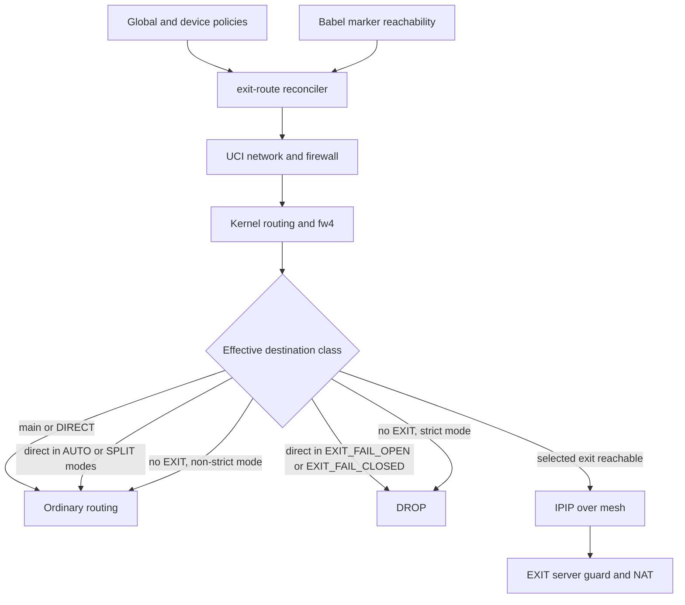

# Управление выходом в интернет (EXIT)

## Назначение и граница ответственности

Подсистема EXIT выбирает, где пользовательский IPv4-трафик покидает mesh-сеть.
Она не определяет физический или overlay-путь до удалённого сервера: этот путь
предоставляет маршрутизация Babel. Не следует смешивать EXIT-политику с
политикой доступа между внутренними сетями и с фильтрацией на самом сервере.

Генератор (`tools/generate_exit.py`, `tools/generate_firewall.py`,
`tools/generate_runtime.py`) создаёт инфраструктуру выхода и начальную
конфигурацию. После развёртывания `exit-route.sh` согласует изменяемые правила
с желаемыми режимами и видимостью выходов. Linux EXIT-сервер обслуживает
отдельную плоскость передачи и применяет собственную финальную фильтрацию.

## Классы назначений и приоритеты

Маршрутизатор различает три класса IPv4-направлений:

1. `main.txt` - постоянные исключения из EXIT-политики, использующие
   обычную таблицу маршрутизации во всех режимах.
1. `direct.txt` - обновляемые префиксы, для которых поведение зависит
   от режима.
1. Остальные назначения - кандидаты на отправку через удалённый EXIT.

При пересечении префиксов `main` имеет приоритет над `direct`.
`main` - не синоним физического WAN: в обычной таблице могут находиться
маршруты к локальным и mesh-узлам, а также default route провайдера.
Это позволяет обращаться к внутренним адресам EXIT-сервера, не пропуская
такие соединения через интернет-выход.

| Режим | `main` | `direct` | Остальные | При отказе EXIT |
|---|---|---|---|---|
| `DIRECT` | main | WAN | WAN | WAN |
| `AUTO` | main | WAN | Первый доступный EXIT | Следующий EXIT, иначе WAN |
| `SPLIT_FAIL_OPEN` | main | WAN | Фиксированный EXIT | WAN |
| `SPLIT_FAIL_CLOSED` | main | WAN | Фиксированный EXIT | DROP (кроме `main` и `direct`) |
| `EXIT_FAIL_OPEN` | main | DROP | Фиксированный EXIT | WAN для остальных, DROP для `direct` |
| `EXIT_FAIL_CLOSED` | main | DROP | Фиксированный EXIT | DROP (кроме `main`) |

`DIRECT` направляет весь пользовательский трафик через WAN. `EXIT_FAIL_CLOSED`
запрещает резервный WAN при отказе EXIT, а `EXIT_FAIL_OPEN` допускает его для
назначений вне `direct`. `AUTO` и `SPLIT_FAIL_OPEN` отличаются автоматическим порядком
выходов и закреплением конкретного сервера. `SPLIT_FAIL_CLOSED` оставляет
`direct` прямым даже при недоступности EXIT.

Суффикс `FAIL_OPEN` разрешает резервный WAN для трафика, который не
блокируется самим режимом. `FAIL_CLOSED` запрещает такой резервный путь.
`AUTO` перебирает EXIT по приоритету, а четыре режима `SPLIT_*` / `EXIT_*`
закреплены за конкретным выходом и не перебирают другие EXIT при отказе.

Исключения `main` не блокируются ни одним режимом: они предназначены
для поддержания overlay и доступа к локальным адресам. Трафик самого
роутера обычно направляется по обычной таблице; глобальная DoH-защита
предусмотрена для `EXIT_FAIL_CLOSED`.

Для индивидуальных устройств предусмотрен `DEFAULT` - наследование
глобальной политики. В `AUTO` устройство может задать свой порядок
`list auto_exit`; при отсутствии списка используется общий приоритет.
`device.disabled=1` временно отключает переопределение. Правила работают
по IPv4-адресу клиента зоны `lan`.

Поддерживается только текущий набор режимов. Неизвестные ключи и
устаревшие значения отклоняются при проверке конфигурации: служба,
генератор и LuCI не выполняют скрытых преобразований режимов.

## Управление и выбор EXIT

Полная блок-схема со всеми шестью ветками (`DIRECT`, `AUTO`, `SPLIT_FAIL_OPEN`,
`SPLIT_FAIL_CLOSED`, `EXIT_FAIL_OPEN`, `EXIT_FAIL_CLOSED`) находится в
[README.md, разделе "Выбор выхода и плоскость данных IPIP"](../../README.md#%D0%B2%D1%8B%D0%B1%D0%BE%D1%80-%D0%B2%D1%8B%D1%85%D0%BE%D0%B4%D0%B0-%D0%B8-%D0%BF%D0%BB%D0%BE%D1%81%D0%BA%D0%BE%D1%81%D1%82%D1%8C-%D0%B4%D0%B0%D0%BD%D0%BD%D1%8B%D1%85-ipip).
Она явно показывает отличие автоматического выбора EXIT от фиксированного,
а также варианты WAN/DROP при недоступности EXIT.

`routers/example/files/etc/config` содержит общие настройки служб, а
индивидуальный `/etc/config/exit_route` генерируется из модели сети.
Глобальная политика задаётся в `routers[].exit_route`, а устройства -
в `routers[].routing_rules` файла `config.json`. Локальные изменения UCI
через LuCI действуют на роутере, но не переносятся в модель при генерации.
В UCI находятся желаемый режим, порядок AUTO и определения EXIT. Это не
журнал текущего состояния сети.
Секции устройств должны быть анонимными: идентичность задаёт поле `ip`,
а не имя UCI-секции. Повторяющиеся IPv4-адреса недопустимы.

LuCI изменяет только `exit_route` через стандартную форму UCI. При
`Save & Apply` OpenWrt создаёт событие `config.change`; `procd`
вызывает `/etc/init.d/exit-route reload`, выполняющий
`exit-route.sh once` без перезапуска основного процесса. Обычная команда
LuCI `Save` ещё не применяет политику. Ручной `uci commit` не создаёт
такое событие: требуется `reload_config` или init-скрипт `reload`.

Скрипт предоставляет `run` (периодический цикл), `once` (согласование)
и `status` (только чтение). Команды `set`, `auto-set`, `device-set` и
аналогичные удалены: они дублировали UCI. Два запуска согласования
сериализуются файловой блокировкой `flock`, освобождаемой ядром
при завершении процесса. UCI загружается заново перед каждым
согласованием, чтобы фоновый цикл видел обновлённые определения EXIT.

Доступность EXIT определяется **только** наличием Babel-маршрута до его
marker prefix. Скрипт периодически опрашивает это состояние; он не
выполняет HTTP-проверки или независимый health-check интернета за выходом.
При появлении более приоритетного выхода `AUTO` может переключиться обратно.
Дополнительное сглаживание колебаний в `exit-route` не предусмотрено.

Для визуализации ближайшего mesh-перехода `status` читает этот же маршрут Babel
из таблицы ядра и выдаёт строку `HOP\t<exit>\t<gateway>\t<interface>`
для доступных EXIT. Дополнительно статус сообщает доступность каждого EXIT.
Если маршрут содержит `dev` и/или `via`, LuCI отображает только поле
интерфейса (`Interface: TROut`).
Это информация о первом переходе, а не полный путь до EXIT. По одному локальному
маршруту промежуточные узлы далее первого перехода определить нельзя.

Глобальные firewall-правила и постоянные policy routing rules создаёт
генератор. Он также создаёт отключённый маршрут глобальной EXIT-таблицы.
Служба изменяет его состояние и выбранный интерфейс, не пересоздавая
этот маршрут. Устройства с индивидуальными политиками требуют
дополнительных правил, которыми служба управляет динамически.

Для глобальных `SPLIT_FAIL_CLOSED` и `EXIT_FAIL_CLOSED` при потере
выбранного Babel-маршрута служба включает `fw4 DROP` для метки `10000`
и адресов вне `main`, сохраняя прямой `direct` в `SPLIT_FAIL_CLOSED`.
Для индивидуального строгого режима применяется отдельный `DROP` по IPv4 устройства.
Переходные блокировки и дополнительные `ip rule unreachable` для
клиентского EXIT не используются. Дополнительный fw4 guard с направлением `dest wan` и меткой строгого
правила блокирует fallback на WAN, даже если IPIP-маршрут отсутствует,
но Babel marker ещё виден. Атомарность обновления fw4 и kernel routes
отдельно не гарантируется.

Неудавшийся commit или reload оставляет в `/tmp` маркер незавершённого
применения для соответствующей подсистемы (`network` либо `firewall`).
Следующее согласование повторяет commit и reload, даже если значения UCI
не изменились. После успешного reload маркер удаляется. При наличии
маркера статус сообщает `APPLY=ERROR`; после успешного применения
`APPLY=OK`. Маркеры переживают перезапуск процесса, но не reboot.
Отдельный runtime-статус содержит `APPLY=OK|ERROR` и `ERROR`;
`ACTIVE` по-прежнему отражает настроенный UCI-маршрут, а не
проверку состояния ядра. Init-служба использует `procd respawn`;
существующий механизм включения служб в образе не изменён.

## Передача пакета и серверная защита

Пакет, назначенный на выбранный EXIT, инкапсулируется в IPIP. Доставка
внешнего IPIP-пакета до сервера опирается на защищённый overlay и Babel.
Промежуточные mesh-роутеры не становятся самостоятельными интернет-выходами.

На EXIT-сервере `servers/example/etc/awg-server.sh` настраивает приём
туннелей, пересылку, NAT и независимый защитный фильтр. Перед выпуском
в интернет сервер отбрасывает назначения как из `main.txt`, так и из
`direct.txt` независимо от режима исходного маршрутизатора.
Дополнительно действует фильтрация BitTorrent через nDPI.
При обновлении списков сервер готовит новые `ipset` и использует
`ipset swap`, не перестраивая действующую цепочку `iptables`. Сервер
устанавливает одну защитную цепочку при `network-up` и восстанавливает
её при отсутствии. Изменение подсетей, интерфейса выхода или имён наборов
требует повторного `network-up`.

Динамический `direct.txt` создаётся общим `update-ipsets.sh` из
заданных стран и ASN. Постоянный `main.txt` строится отдельно из
специальных сетей и адресов инфраструктуры. На маршрутизаторе и сервере
списки используются разными подсистемами, но собираются согласованным
кодом. Серверный `exit-direct-guard` обновляет наборы и при необходимости правила.

## Отказы, состояния и гарантии

- При исчезновении marker route `AUTO` выбирает следующий доступный EXIT,
  при отсутствии всех целей использует WAN.
- `SPLIT_FAIL_OPEN` и `EXIT_FAIL_OPEN` закреплены за выбранным сервером и не переходят на
  следующий EXIT. `SPLIT_FAIL_OPEN` при отказе идёт через WAN, `EXIT_FAIL_OPEN` при отказе
  использует WAN только для не-`direct` направлений.
- `SPLIT_FAIL_CLOSED` при отказе сохраняет WAN для `direct`, остальное блокирует.
- `EXIT_FAIL_CLOSED` блокирует `direct` и, при отказе, остальное вне `main`.
- Для строгих режимов дополнительно устанавливается guard на выход в
  firewall-зону WAN, чтобы отсутствие IPIP default route не вызывало обход.
- `main` продолжает использовать обычную таблицу даже в `EXIT_FAIL_CLOSED`.
- Индивидуальный режим имеет приоритет над глобальным; `DEFAULT` наследует его.
- Необязательный `device.auto_exit` применяется лишь в `AUTO` данного клиента.
- Отключённое правило устройства наследует глобальную политику.
- Управление mesh и транспортными соединениями не должно зависеть от
  выбранного пользовательского интернет-выхода.
- Локальный трафик роутера обычно использует обычную маршрутизацию.
  DoH имеет отдельную связь с глобальной EXIT-политикой.

## Компромиссы и границы проверки

- Отдельная IPIP-инкапсуляция отделяет выбор выхода от маршрута до него,
  но добавляет заголовки и требования к MTU.
- Babel-путь подтверждает достижимость узла, а не доступность внешнего интернета.
- OpenWrt не применяет UCI network и firewall одной атомарной транзакцией.
  Отсутствие утечек в моменты reload необходимо проверять на реальном устройстве.
- Правильный порядок классификации `main`, индивидуальных правил и DROP
  зависит от фактического поведения fw4; статический анализ его не доказывает.
- IPv6 сознательно пока не охвачен эквивалентной EXIT-политикой;
  гарантии таблицы относятся к пользовательскому IPv4.
- Переключение EXIT может разорвать существующие соединения из-за смены
  точки выхода и состояния NAT.

## Где смотреть исходники

- Модель и начальные настройки: `tools/config_exit_model.py`,
  `tools/generate_runtime.py`, `tools/generate_exit.py`.
- Зоны и правила роутера: `tools/generate_firewall.py`,
  `tools/generate_network.py`.
- Согласование на роутере: `routers/example/files/etc/scripts/exit-route.sh`.
- Списки назначений: `routers/example/files/etc/scripts/update-ipsets.sh`.
- Серверный data plane и финальная защита:
  `servers/example/etc/awg-server.sh`.
