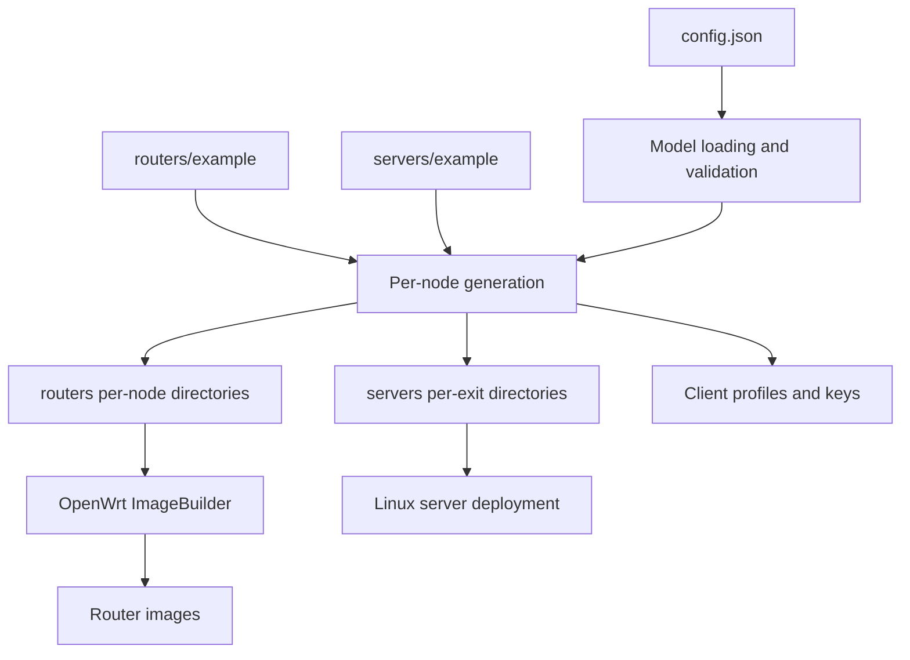

# Генерация и развёртывание конфигураций

## Назначение

Проект разделяет подготовку конфигурации и управление работающей сетью.
Python-генератор преобразует одну декларативную модель в файлы для
конкретных OpenWrt-роутеров и Linux EXIT-серверов. После установки
прошивок и серверных служб сеть работает без постоянно запущенного
центрального генератора. Это снижает runtime-зависимости и переносит
проверку структуры в этап подготовки артефактов.

## Источники истины и производные артефакты

`config.json` описывает топологию, адресацию, роли, группы доступа и
политики. `routers/example` и `servers/example` содержат общие файлы,
которые нельзя независимо поддерживать в каждом производном каталоге.
`routers/<router>` и `servers/<exit>` получают индивидуальные параметры
из модели и общих шаблонов. Эти каталоги являются результатом генерации,
но также могут содержать явно допускаемые пользовательские части.

## Границы компонентов

| Компонент | Ответственность |
|---|---|
| `generate_configs.py` | Оркестрация генерации, синхронизации и проверок |
| `tools/config_*.py` | Загрузка и проверка декларативной модели |
| `tools/generate.py` | Сборка сетевых и серверных конфигураций |
| `tools/sync_rules.py` | Согласование общих файлов с шаблонами |
| `tools/managed_blocks.py` | Различение управляемых и пользовательских UCI-секций |
| `tools/secrets.py`, `tools/materials.py` | Жизненный цикл ключевого материала |
| `build_router_images.py` | Сборка прошивок для профилей устройств |
| `deploy_servers.py` | Доставка серверных файлов и служб |
| `upgrade_routers.py` | Обновление прошивок целевых роутеров |
| `tools/show_unmanaged.py` | Отчёт о файлах вне управления генератора |

## Границы владения конфигурацией

Генератор владеет постоянной сетевой инфраструктурой, общими firewall
правилами, серверными параметрами и определениями EXIT. Его задача -
создать полный набор согласованных файлов для узла.

Изменяемое состояние на работающем роутере принадлежит локальным
службам. Например, глобальный маршрут EXIT создаётся заранее,
а `exit-route.sh` изменяет его состояние и выбранный интерфейс;
индивидуальные правила устройств служба может создавать и удалять.
Динамические маршруты Babel не сохраняются генератором как текущий статус.

На уровне файлов действуют различные стратегии:

- `network_part`, `firewall_part`, `dhcp_part` полностью генерируются и
  удаляют ручные секции при следующей генерации. Их нельзя использовать как
  долговременное хранилище пользовательских правил.
- DHCP-хосты и индивидуальные DHCP-опции задаются через
  `routers[].dhcp_hosts` в `config.json`,
  а прочие пользовательские UCI-изменения - в `customization()`.
- `exit_route` целиком генерируется из `routers[].exit_route` и
  `routers[].routing_rules` в `config.json`. Локальные изменения LuCI
  действуют на работающем роутере, но не переживают новую генерацию.
  Секции `config device` анонимные, их идентичность задаётся `option ip`.
- `99-firstboot-custom` содержит управляемую и пользовательскую части,
  которые синхронизируются по предусмотренной границе.
- Секреты и ключи переиспользуются только в текущем зашифрованном формате
  `OWMB_ENC_MATERIAL_V1`. Старые или открытые значения отвергаются вместо
  преобразования. Новые ключи создаются и шифруются штатно;
  принудительная регенерация инфраструктурных ключей выделена отдельно.

Поэтому редактирование сгенерированного файла не всегда эквивалентно
изменению декларативной модели. Границу владения нужно проверять перед
любой автоматизацией обновления.

## Жизненный цикл

**Генерация.** Модель читается и проверяется, недостающие APK
загружаются, затем выполняется очистка генерируемых деревьев с сохранением
ключей и пользовательского кода. После этого синхронизируются шаблоны,
формируются туннели, access-профили, сетевые UCI-фрагменты, серверная
runtime-конфигурация и списки адресов. Затем выполняются проверки
артефактов и отчёт по unmanaged-частям.

**Валидация входных данных.** Все имена параметров сверяются с текущей схемой,
повторяющиеся JSON-ключи и неизвестные или открытые секретные маркеры
отвергаются. Неизвестные имена маркеров не имеют отдельных миграционных
веток: отклоняются по тому же общему правилу, что и остальные ошибки входа.
Вспомогательные команды используют тот же загрузчик JSON.
При чтении ранее сохранённых приватных ключей принимается только
`OWMB_ENC_MATERIAL_V1` без автоматической миграции.

**Согласованность EXIT Route.** Генератор принимает только актуальные
режимы и опции без миграций и версий схемы. При ошибочных значениях
генерация прекращается, а не подставляет безопасные или нестрогие режимы.
Обновление на роутере должно доставить вместе службу
`exit-route.sh`, сгенерированный `firewall_part` (включая правила
`ExitRouteWanGuard*`), сетевую конфигурацию и новую LuCI-страницу.
Обновление только одного компонента не является поддерживаемым сценарием:
служба проверяет наличие новых правил перед применением. `sysupgrade -n`
сбрасывает live UCI, поэтому желаемые изменения, сделанные только в LuCI,
нужно вручную перенести в `config.json` перед обновлением.

**Установка роутера.** ImageBuilder создаёт образ с файлами выбранного
роутера. На первом запуске `99-firstboot-custom` переносит подготовленные
UCI-фрагменты в системные конфигурации. После этого работают собственные
механизмы OpenWrt, Babel и локальные службы.

**Установка сервера.** `deploy_servers.py` доставляет файлы из
`servers/<exit>`. Runtime на сервере использует systemd и собственный
сетевой скрипт, а не OpenWrt UCI.

**Очистка генерируемых каталогов.** `generate_configs.py --clean` не
запускает обычную генерацию: для перечисленных в модели узлов удаляет все
производные файлы, оставляя только необходимые для регенерации туннельные
приватные ключи (`network_part`, серверные AWG `.conf`), Access CA и
клиентские профили, а также пользовательскую часть до маркера
`99-firstboot-custom`, включая `customization()`.
Деревья после clean не предназначены для сборки или деплоя. Шаблоны
`example` и внешние SSH-ключи не меняются; посторонние каталоги узлов
блокируют очистку. Генерируемый UCI `exit_route` удаляется без сохранения локальных
изменений. Следующая генерация восстанавливает его из `config.json`.

**Обновление локальных APK.** `generate_configs.py --update-packages`
после проверки модели полностью удаляет кэш `packages/` и копии APK из
`routers/*/packages/`, не затрагивая конфиги и ключи. Затем загружает
новые APK из Releases для актуальных профилей и копирует их по роутерам.
Отсутствующий в релизе пакет приводит к ошибке, прежний APK не сохраняется.
Это самостоятельный режим без генерации, `--clean` и деплоя.

**Повторная генерация.** Обычный `generate_configs.py` после проверки модели и
загрузки пакетов автоматически выполняет ту же очистку, что и `--clean`, и
затем полностью пересоздаёт конфигурации. Изменённая модель пересчитывает UCI-фрагменты
целиком; произвольные ручные секции внутри них удаляются. Bootstrap customization и ключевой материал имеют собственные правила
сохранения; политики EXIT выводятся из `config.json`. Генератор не переносит изменения с
работающего роутера обратно в локальную модель автоматически.
Список изменённых и удалённых файлов вычисляется сравнением содержимого и прав
до очистки и после полной генерации, а не по промежуточным записям.

**Обновление прошивки.** `upgrade_routers.py` намеренно использует
`sysupgrade -n`: обновление начинает с чистой конфигурации нового образа.
Runtime-изменения, сделанные только на устройстве, не переносятся
автоматически. Источник состояния после обновления - генератор и его
локальные материалы, а не копия настроек работающего роутера.

## Решения, компромиссы и ограничения

- Единая модель сокращает расхождения между узлами, но ошибка модели
  может распространяться на многие сгенерированные конфигурации.
- Общие шаблоны уменьшают дублирование, но требуют явных правил
  сохранения индивидуальных правок.
- Генерация и runtime разделены: работающая сеть не зависит от компьютера,
  на котором создавались файлы, но изменения требуют нового развёртывания.
- Применение `network` и `firewall` не атомарно: это ограничение OpenWrt.
  Безопасность промежуточных состояний нуждается в отдельной проверке.
- Имена управляемых UCI-объектов составляют внутренний контракт генератора
  и `exit-route.sh`. Они выпускаются в одном комплекте, но частичное
  обновление только службы без обновления конфигурации может быть несовместимым.
- Ключи и локальные исключения имеют свой жизненный цикл; их нельзя
  безусловно пересоздавать вместе с обычными конфигурациями.
- Полный набор целевых файлов зависит от фактической топологии.
  В архиве исходников без `config.json` это нельзя проверить на конкретных узлах.

## Где смотреть исходники

- Оркестрация и модель: `generate_configs.py`, `tools/config_model.py`,
  `tools/config_builder.py`, `tools/generate.py`.
- Генерация частей конфигурации: `tools/generate_network.py`,
  `tools/generate_firewall.py`, `tools/generate_runtime.py`,
  `tools/generate_server_runtime.py`.
- Шаблоны и стратегия синхронизации: `routers/example/`, `servers/example/`,
  `tools/sync_rules.py`, `tools/managed_blocks.py`.
- Сборка и развертывание: `build_router_images.py`, `deploy_servers.py`,
  `upgrade_routers.py`.

Access-группы описываются внутри соответствующих `routers[].access`;
корневой `access` не является допустимым ключом конфигурации.
