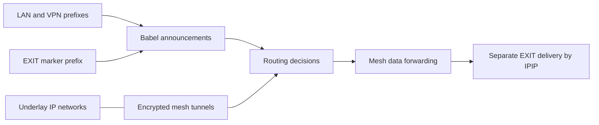

# Связность и маршрутизация mesh

## Назначение

Маршрутизация mesh соединяет удалённые роутеры, их разрешённые сети и
EXIT-серверы в одну L3-среду поверх сторонних IP-сетей. Она отвечает
за достижимость и выбор внутреннего пути, но не заменяет контроль доступа
или выбор интернет-выхода. Рабочая маршрутизация выполняется на узлах;
центрального маршрутизатора-контроллера после генерации нет.

## Три раздельных слоя

| Слой | Ответственность | Механизм в проекте |
|---|---|---|
| Underlay | Базовая IP-связность через провайдеров и NAT | WAN, публичные endpoints |
| Overlay | Защищённые межузловые L3-каналы | AmneziaWG/WireGuard |
| Control plane | Достижимость префиксов и выбор пути | Babel |

Дополнительный IPIP для доставки пользовательского трафика до EXIT
относится к плоскости передачи и использует готовую mesh-связность.
Babel не принимает решение, какой EXIT выбрал пользователь.

## Топология и направление соединений

Модель различает spine/hub, leaf, access-only и EXIT-узлы.
Генератор задаёт набор туннелей между допустимыми парами;
публичные узлы могут принимать соединения, а узлы за NAT инициируют
исходящие. Для некоторых EXIT предусмотрены обратные соединения
к публичным mesh-hub; есть и связи между EXIT-серверами.
Состав линков определяется моделью, а не автономно обнаруживается
во время работы.

Избыточность реализуется через несколько независимых логических связей.
При потере одного канала Babel может выбрать другой объявленный путь.
При потере всех путей достижимость соответствующего префикса исчезает.
Гарантия сохранения связности при любом наборе отказов из наличия
избыточных каналов сама по себе не следует.

## Контрольная и пользовательская плоскости

Babel распространяет допустимые префиксы через overlay-интерфейсы.
На роутерах `tools/generate_network.py` формирует конфигурацию интерфейсов
Babel и фильтров redistribution. Сети LAN и разрешённые access-интерфейсы
могут анонсироваться; локальные маршруты не распространяются безусловно.
На EXIT-серверах конфигурация формируется
`tools/generate_server_runtime.py`.

Маршрут до marker prefix служит также сигналом доступности EXIT для
`exit-route.sh`. Сама служба этот маршрут не создаёт: она читает
состояние, полученное от Babel. Таким образом, изменение топологии
автоматически влияет на выбор пути, а выбор интернет-выхода остаётся
отдельной политикой.

## Адресация и идентичность

`tools/link_model.py`, `tools/net_model.py`, `tools/stable_model.py` и
`tools/identifiers.py` выводят параметры линков и идентификаторы из
декларативной модели. Связи имеют воспроизводимую служебную адресацию.
Ключевой материал формируется и переиспользуется отдельно;
перегенерация линков не должна непреднамеренно менять криптографическую
идентичность узлов.

Устойчивые адреса и имена упрощают настройку маршрутов и диагностику,
но требуют контролировать конфликты и изменения модели.
Генератор проверяет это до выпуска конфигураций; на уровне runtime
Babel отвечает только за информацию о доступности маршрутов.

## Основные сценарии

**Поднятие новой связи.** Генератор создаёт параметры обеих сторон.
После развёртывания устанавливается защищённый канал, Babel получает
соседа и анонсы, а маршрутизаторы включают подходящие маршруты.

**Отказ линии.** Исчезает сосед или его маршруты; Babel пересчитывает
достижимость. Передача может перейти на другой туннель без изменения
конфигурации EXIT. Детектор доступности EXIT также наблюдает результат.

**Изменение источников маршрутов.** Изменение LAN или access-сети
проходит через генерацию и разрешённые фильтры анонсирования.
Простое появление маршрута в основной таблице роутера не означает
автоматического экспорта его во всю mesh-сеть.

**Запрос к внутреннему узлу.** Обычная таблица маршрутизации выбирает
путь до адреса; firewall независимо определяет, разрешено ли подключение.
Трафик к внутренним адресам не следует автоматически считать трафиком
через интернет-выход.

## Решения, компромиссы и ограничения

- Выбран распределённый control plane: сеть продолжает работать без
  процесса генерации, но сходимость и выбор пути зависят от Babel.
- Overlay скрывает особенности провайдерской связности и обеспечивает
  защищённый транспорт ценой дополнительных заголовков и ограничений MTU.
- Явное анонсирование с фильтрами уменьшает риск ошибочного распространения
  маршрутов. Неправильная декларативная модель всё равно может породить
  нежелательные анонсы.
- Маршрутизация и firewall независимы: наличие пути не даёт права доступа.
- Достижимость marker prefix не гарантирует работоспособность интернета
  за EXIT-сервером или исправность отдельного IPIP data plane.

## Где смотреть исходники

- Топология и параметры линков: `tools/config_model.py`,
  `tools/link_model.py`, `tools/tunnel_model.py`.
- Создание mesh-туннелей: `tools/generate_mesh.py`,
  `tools/generate_exit.py`.
- Babel на роутерах: `tools/generate_network.py`.
- Babel на серверах: `tools/generate_server_runtime.py`.
- Контроль маршрутов при выборе выхода:
  `routers/example/files/etc/scripts/exit-route.sh`.
